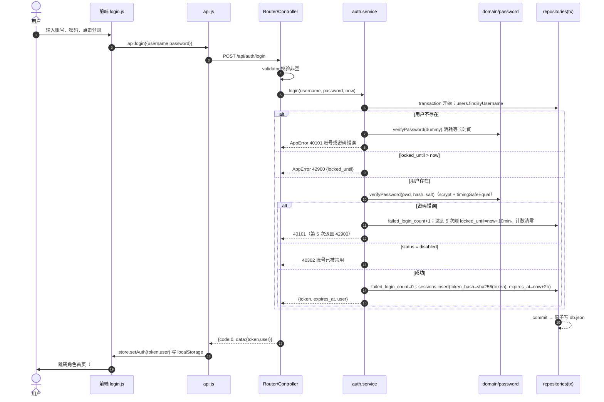
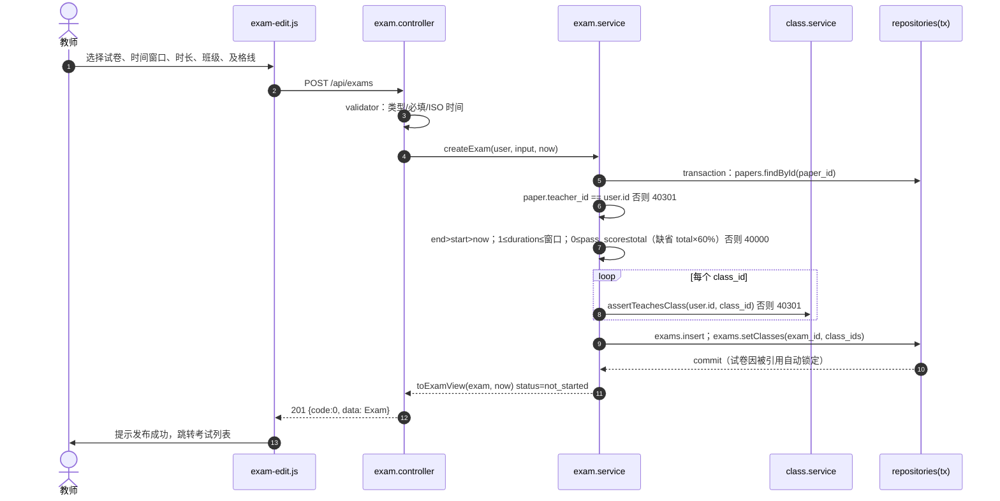
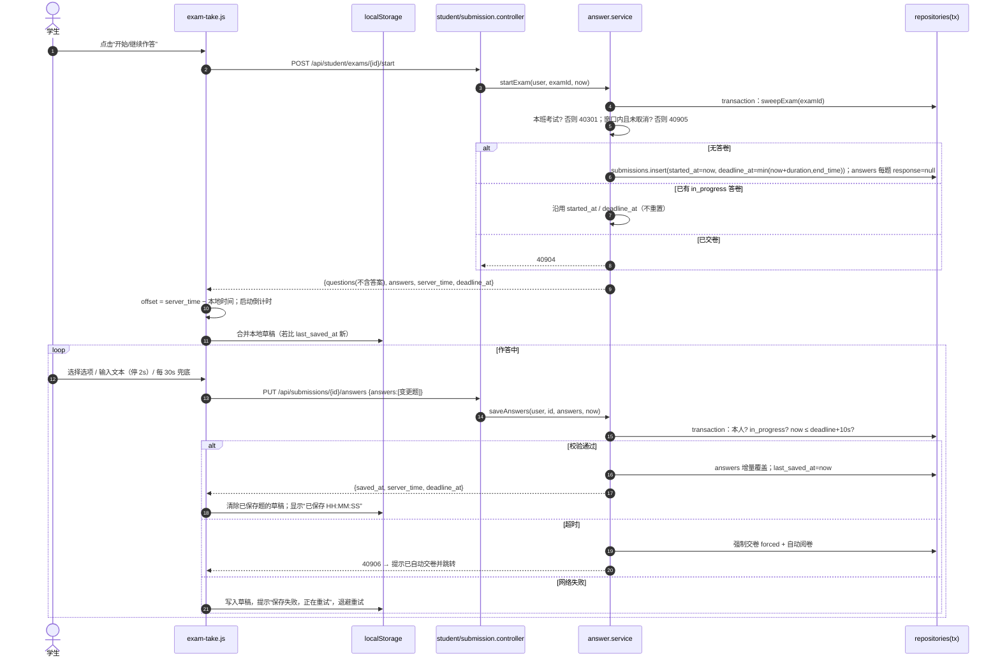
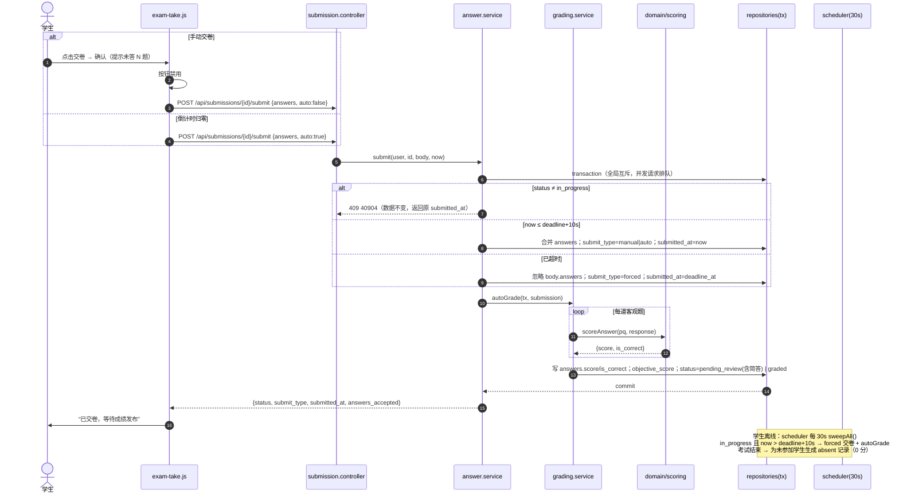
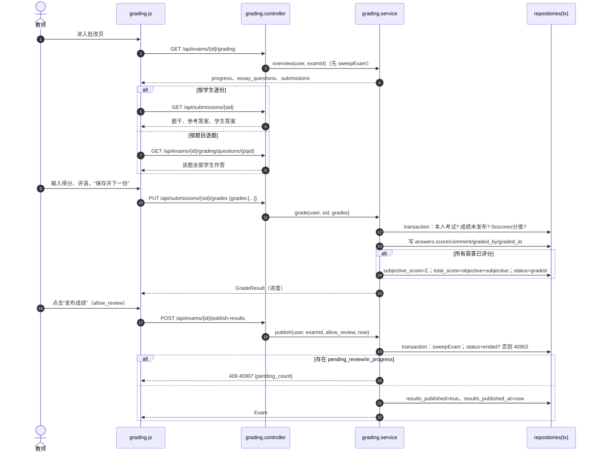
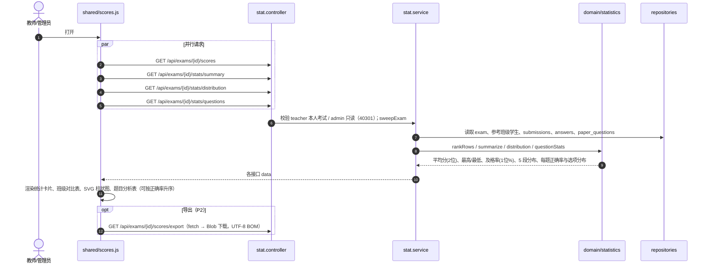
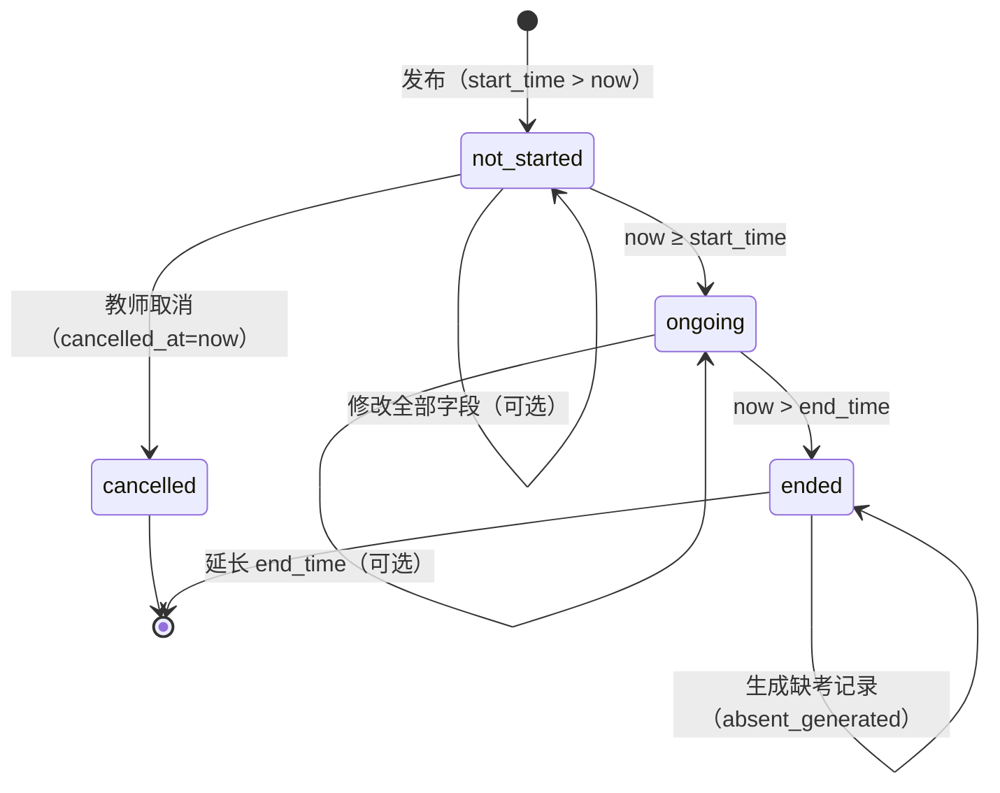
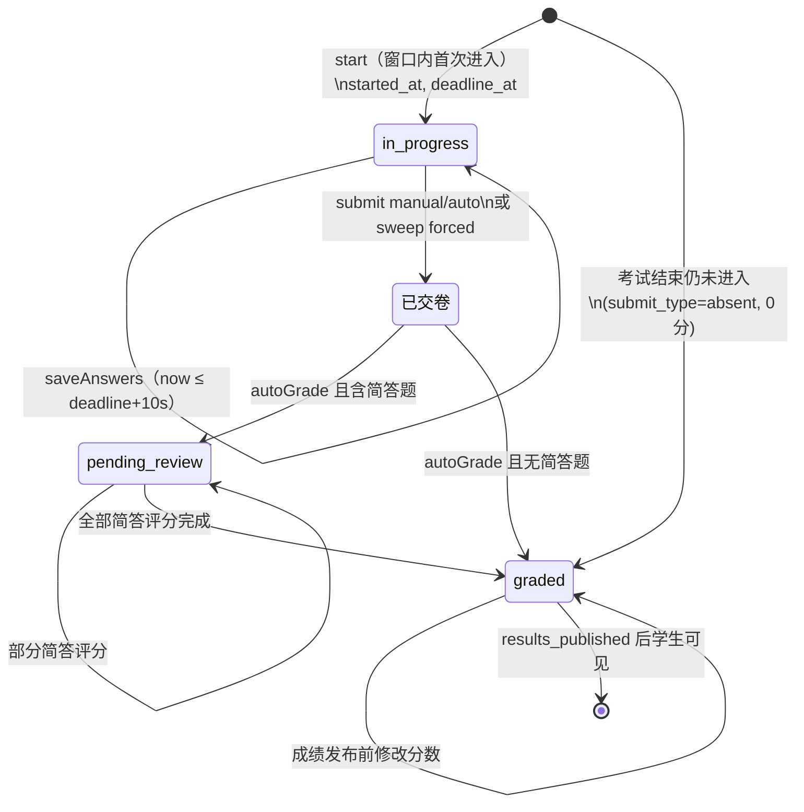

# 在线考试系统 系统设计文档

| 项目 | 内容 |
| --- | --- |
| 文档版本 | V1.0 |
| 编写角色 | 系统架构师 |
| 输入 | requirements/需求规格说明书.md（FR 33、NFR 15）、用例图、需求追踪矩阵 |
| 配套产出 | `api-contract.yaml`（OpenAPI 3.0，62 个接口，前后端唯一依据）、`架构图.puml`、`ER图.puml`、`database/ddl.sql`、`database/json-schema.md` |
| 下游使用者 | 后端开发者、前端开发者、测试工程师、论文撰写者、答辩助手 |

> 约定优先级：**api-contract.yaml > 本文档 > 其他**。若开发中发现契约缺陷，由架构师修订契约并在 team/log.md 记录，开发者不得自行改变接口形状。

---

## 1 技术选型及理由

| 层面 | 选型 | 理由 |
| --- | --- | --- |
| 运行时 | Node.js ≥ 18，ES Module（`.mjs`） | 内置 `node:http`、`node:crypto`（scrypt / randomBytes / timingSafeEqual）、`node:fs/promises`、`node:test` 已覆盖 HTTP 服务、加密、持久化与测试全部需要；跨平台；前后端同为 JavaScript，降低学习成本 |
| 第三方依赖 | **零依赖** | ① 满足约束 C-01；② 无 `npm install`，`node server.mjs` 一条命令启动（NFR-15）；③ 无供应链风险与版本漂移；④ 毕设答辩中每一行关键代码（路由、鉴权、原子写、判分）都可自主讲解，体现工作量与原理掌握 |
| Web 框架 | 自研轻量路由（约 100 行） | 只需“方法 + 路径参数匹配 + 中间件”，无需 Express；路由表集中声明角色，便于审计 RBAC |
| 存储 | 单文件 JSON（`backend/data/db.json`）+ 仓储层封装 | ① 满足 C-03 单进程部署；② 数据规模（≈1000 用户、2000 题、5000 答卷，约 10~20MB）可全量驻留内存，查询为内存遍历，远低于 NFR-01 的 300ms；③ 文件可直接查看，便于演示与调试；④ 通过仓储接口隔离，**迁移方案**见 §1.1 |
| 鉴权 | scrypt + 16 字节随机盐；32 字节随机令牌（Bearer）；服务端会话表 | scrypt 为内置慢哈希，抗 GPU 爆破；服务端会话可即时吊销（退出、禁用、改密立即失效，NFR-05），JWT 做不到 |
| 前端 | 原生 JS SPA、hash 路由、ES Module 直接由浏览器加载 | 满足 C-02，无构建步骤；hash 路由无需服务端路由回退；首屏资源可控制在 300KB 内（NFR-03） |
| 图表 | 原生 SVG 柱状图组件 | 分数段分布仅需柱状图，无需引入图表库 |
| 测试 | `node --test` + `--experimental-test-coverage` | 内置能力（NFR-14），零依赖 |

### 1.1 JSON 存储的局限与迁移方案

| 局限 | 本设计的应对 |
| --- | --- |
| 并发写覆盖 | 单进程内全局事务互斥锁（`transaction()` 串行执行），读-校验-写在同一事务内完成 |
| 写入中断导致文件损坏 | 写 `db.json.tmp` → `fsync` → `rename` 原子替换（NFR-10） |
| 每次写全量序列化开销 | 写队列合并：同一时间窗内的多次提交合并为一次落盘；会话续期每 60s 最多写一次 |
| 无法水平扩展 | 课题规模单进程足够（A-06：单场 ≤200 人）；需要扩展时迁移 MySQL |

**迁移到 MySQL 8 的步骤**：
1. 执行 `design/database/ddl.sql`（表/字段与 db.json 集合/字段一一对应）；
2. 运行一次性导入脚本按依赖顺序导入（见 `json-schema.md §5`）；
3. 新增 `backend/src/repositories/mysql/` 实现与 JSON 版**相同的仓储接口**（§6.1），`transaction(fn)` 映射为 `BEGIN … COMMIT`，关键行加 `SELECT … FOR UPDATE`；
4. `config.STORAGE` 改为 `mysql`。服务层、控制器、前端均不改动（NFR-13）。

---

## 2 总体架构

### 2.1 分层架构

```
浏览器 SPA ──HTTP JSON /api/*──▶ ┌──────────────────────────────────────────────┐
                                 │ 接入层 core/: http Server → 静态文件 / API 分发 │
                                 │   body 解析(≤1MB)、统一响应信封、错误捕获      │
                                 ├──────────────────────────────────────────────┤
                                 │ 路由层 routes/ + core/router.mjs               │
                                 │   方法+路径匹配；每条路由声明 roles             │
                                 ├──────────────────────────────────────────────┤
                                 │ 中间件 middleware/auth.mjs                     │
                                 │   令牌→会话→用户；滑动续期；RBAC 角色校验       │
                                 ├──────────────────────────────────────────────┤
                                 │ 控制器 controllers/                            │
                                 │   取参、validator 校验、调用服务、组装响应      │
                                 ├──────────────────────────────────────────────┤
                                 │ 服务层 services/   ◀── domain/ 纯函数           │
                                 │   业务规则、资源归属校验、事务边界              │
                                 ├──────────────────────────────────────────────┤
                                 │ 仓储层 repositories/  统一接口（async）         │
                                 ├──────────────────────────────────────────────┤
                                 │ 存储 json-store.mjs → data/db.json（原子写）    │
                                 └──────────────────────────────────────────────┘
```

| 层 | 职责 | 禁止 |
| --- | --- | --- |
| 接入层 | 创建 `http.Server`；`/api/*` 交给路由，其余交给静态文件服务；设置安全响应头；兜底捕获异常并转为 50000 | 不含业务逻辑 |
| 路由层 | 路由表 `{method, path, roles, handler}`；路径参数（`:id`）解析为整数并校验（非法 → 40000）；无匹配路径 → 40400，路径匹配方法不匹配 → 40500 | — |
| 中间件 | 解析 `Authorization: Bearer`；校验会话、用户状态；`roles` 不含当前角色 → 40300 | 不做资源归属校验 |
| 控制器 | 从 `ctx.params / ctx.query / ctx.body` 取参，调用 validator，调用服务，`return data`（由框架包信封），或 `ctx.status = 201` | 不直接访问仓储 |
| 服务层 | 业务规则、**资源归属校验**（40301）、状态机校验、调用 domain 纯函数；写操作包在 `repos.transaction()` 内 | 不 `import 'node:fs'`；不感知 HTTP |
| domain | 无副作用纯函数：密码哈希、题目结构校验、判分、状态计算、随机抽题、统计、CSV | 不访问仓储 |
| 仓储层 | 按实体封装查询/增删改；对外返回**深拷贝**，防止服务层误改内存数据 | 不含业务规则 |
| 存储 | 内存数据、互斥锁、序列号、原子落盘 | — |

### 2.2 请求处理管线

```
req → setSecurityHeaders → (path 以 /api/ 开头?)
        否 → static.serve(frontend/)
        是 → router.match → readJsonBody(≤1MB) → authenticate(除 public) → requireRole(route.roles)
             → controller(ctx) → sendJson(200|201, {code:0,message:'ok',data})
        任一环节抛 AppError → sendJson(err.http, {code, message, data})
        其他异常 → console.error + 50000
```

`ctx` 结构：`{ req, res, method, path, params, query, body, user, session, now }`，其中 `now` 由 `core/clock.mjs` 提供（测试可注入假时钟）。

---

## 3 目录结构（开发者照此创建）

### 3.1 backend/

```
backend/
├── package.json                    # {"name":"online-exam","type":"module","engines":{"node":">=18"},
│                                   #  "scripts":{"start":"node server.mjs","test":"node --test test/",
│                                   #  "test:cov":"node --test --experimental-test-coverage test/",
│                                   #  "seed:demo":"node scripts/seed-demo.mjs"}}，无 dependencies
├── server.mjs                      # 入口：加载 config → 打开 JsonStore → 空库则 seed → createApp → listen → 启动 scheduler；SIGINT/SIGTERM 时 flush 后退出
├── data/                           # 运行时生成（.gitignore）：db.json
├── scripts/
│   └── seed-demo.mjs               # 【可选】生成 NFR-14 演示数据（2 教师、2 班、≥20 学生、≥30 题、1 场考试）
├── src/
│   ├── config.mjs                  # 集中配置（§3.3），支持环境变量覆盖
│   ├── app.mjs                     # createApp({config, repos, services, clock}) → (req,res)=>{}；供 server 与集成测试复用
│   ├── seed.mjs                    # seedIfEmpty(repos)：写入 4 个账号、1 个班级、3 个标签、10 道示例题
│   ├── core/
│   │   ├── router.mjs              # Router：add(method, path, {roles, handler})、match(method, path) → {route, params} | 405 | 404
│   │   ├── http.mjs                # readJsonBody(req, limit)、sendJson(res, status, body)、sendCsv(res, filename, text)、parseQuery(url)
│   │   ├── errors.mjs              # class AppError(code, message, data)；ERR 常量表（code→http,message）；helpers：badRequest/forbidden/notFound/conflict…
│   │   ├── validator.mjs           # 轻量校验：v.int/v.str/v.enum/v.bool/v.arr/v.iso/v.score1(1 位小数)，收集 errors[{field,message}] 后抛 40000
│   │   ├── static.mjs              # serveStatic(rootDir)：MIME 表、path.resolve 后校验仍在 rootDir 内（防穿越）、"/"→index.html、ETag/304
│   │   ├── clock.mjs               # now() → Date；setNow() 仅测试使用
│   │   └── pagination.mjs          # parsePage(query) → {page,page_size}；paginate(array,{page,page_size}) → {items,total,page,page_size}
│   ├── middleware/
│   │   └── auth.mjs                # authenticate(ctx)：Bearer→sha256→session→user；滑动续期；requireRole(ctx, roles)
│   ├── routes/
│   │   └── index.mjs               # registerRoutes(router, controllers)：62 条路由（与契约 operationId 一一对应），声明 roles
│   ├── controllers/
│   │   ├── auth.controller.mjs     # login / logout / getMe / changePassword
│   │   ├── user.controller.mjs     # listUsers / createUser / getUser / updateUser / deleteUser / resetUserPassword
│   │   ├── class.controller.mjs    # listClasses / createClass / getClass / updateClass / deleteClass / getClassMembers / addClassStudents / removeClassStudents / setClassTeachers
│   │   ├── tag.controller.mjs      # listTags / createTag / renameTag / deleteTag
│   │   ├── question.controller.mjs # listQuestions / createQuestion / importQuestions / getQuestion / updateQuestion / deleteQuestion
│   │   ├── paper.controller.mjs    # listPapers / createPaper / generateRandomPaper / replaceRandomQuestion / getPaper / updatePaper / deletePaper / copyPaper
│   │   ├── exam.controller.mjs     # listExams / createExam / getExam / updateExam / cancelExam / getExamMonitor
│   │   ├── student.controller.mjs  # listStudentExams / getStudentExam / startExam / listStudentResults / getStudentResult
│   │   ├── submission.controller.mjs # getSubmission / saveAnswers / submitSubmission
│   │   ├── grading.controller.mjs  # gradeSubmission / getGradingOverview / getGradingByQuestion / publishResults / unpublishResults
│   │   ├── stat.controller.mjs     # getScoreSheet / exportScoreSheet / getStatsSummary / getStatsDistribution / getStatsQuestions
│   │   └── admin.controller.mjs    # getOverview
│   ├── services/
│   │   ├── auth.service.mjs        # login（锁定策略）、logout、changePassword、resolveSession（续期）
│   │   ├── user.service.mjs        # 用户 CRUD、禁用即踢下线、重置密码、删除前引用检查
│   │   ├── class.service.mjs       # 班级 CRUD、成员管理、任课关系；assertTeachesClass(teacherId, classId)
│   │   ├── tag.service.mjs         # 标签 CRUD、ensureTags(teacherId, names) 自动建标签
│   │   ├── question.service.mjs    # 题目 CRUD（逻辑删除）、检索+汇总、批量导入；assertOwnQuestion
│   │   ├── paper.service.mjs       # 组卷保存（快照、分组排序）、随机生成/替换、锁定检查、复制
│   │   ├── exam.service.mjs        # 发布/修改/取消、列表 counts、监控；toExamView(exam, now)
│   │   ├── answer.service.mjs      # 学生考试列表、开始/继续、保存、交卷（幂等）、sweepExam / sweepAll（超时兜底、缺考生成）
│   │   ├── grading.service.mjs     # autoGrade(submission)、gradeEssays、批改总览、发布/撤回成绩、学生成绩视图
│   │   ├── stat.service.mjs        # 成绩单、概要统计、分数段、每题分析、CSV、系统概览
│   │   └── scheduler.service.mjs   # startScheduler()：每 30s sweepAll；每 10min 清理过期会话；返回 stop()
│   ├── domain/
│   │   ├── password.mjs            # hashPassword(pwd) → {hash,salt}；verifyPassword(pwd,hash,salt)（timingSafeEqual）；checkPasswordPolicy(pwd)
│   │   ├── token.mjs               # generateToken() → 64 位 hex；hashToken(token) → sha256 hex
│   │   ├── question-rules.mjs      # validateQuestionInput(input) → errors[]；countBlanks(stem)；normalizeAnswer(type, answer)
│   │   ├── scoring.mjs             # scoreAnswer(pq, response) → {score,is_correct}；splitFillScore(score,n)；validateResponseShape(pq, response)
│   │   ├── exam-status.mjs         # examStatus(exam, now)；computeDeadline(startedAt, exam)；studentExamStatus(exam, submission, now)；GRACE_MS
│   │   ├── random-picker.mjs       # pickRandom(pool, count, rng)；drawByRules(questions, rules, rng) → {items} | {shortages}
│   │   ├── statistics.mjs          # summarize(rows, passScore)；distribution(rows, totalScore)；questionStats(pqs, answers, actualCount)；rankRows
│   │   ├── shuffle.mjs             # seededShuffle(array, seed)（选项乱序 P2）
│   │   └── csv.mjs                 # toCsv(headers, rows)（转义逗号/引号/换行，前置 BOM）
│   └── repositories/
│       ├── index.mjs               # createRepositories(store) → {users, sessions, classes, tags, questions, papers, exams, submissions, transaction, counts}
│       ├── json-store.mjs          # class JsonStore：open(file)、data、nextId(coll)、runExclusive(fn)、commit()（写队列+原子写）、flush()
│       ├── base.repository.mjs     # class BaseRepository(store, coll)：findById/findOne/findMany(pred)/insert/update/remove/removeWhere/count，返回深拷贝
│       ├── user.repository.mjs     # findByUsername、listFiltered({role,class_id,status,keyword})、countByRole
│       ├── session.repository.mjs  # findByTokenHash、removeByUser(userId, exceptId)、removeExpired(now)
│       ├── class.repository.mjs    # findByName、listTeachers(classId)、setTeachers、listClassIdsByTeacher、listStudents(classId)
│       ├── tag.repository.mjs      # listByTeacher、findByName(teacherId,name)、questionCount(tagId)
│       ├── question.repository.mjs # listByTeacher(filters)、setTags(qid, tagIds)、tagNamesOf(qid)、refCount(qid)
│       ├── paper.repository.mjs    # listByTeacher、listQuestions(paperId)、replaceQuestions(paperId, pqs)、examRefCount(paperId)
│       ├── exam.repository.mjs     # listByTeacher/listAll、classIdsOf(examId)、setClasses、listByClass(classId)
│       └── submission.repository.mjs # findByExamStudent、listByExam、listExpired(now-grace)、answersOf(subId)、upsertAnswers、listByStudent
└── test/                           # 测试工程师负责（node:test），本设计不规定文件
```

### 3.2 frontend/

```
frontend/
├── index.html                      # 单页外壳：<div id="app">、<div id="toast">、<div id="modal-root">；<link css/style.css>；<script type="module" src="js/main.js">
├── css/
│   └── style.css                   # CSS 变量主题、布局（≥1280 完整、答题页 ≥375 可用）、表格/表单/按钮/卡片/答题卡/倒计时样式
└── js/
    ├── main.js                     # 启动：store.restore() → 有 token 则 api.getMe() → router.start()
    ├── router.js                   # hash 路由表（§5.1）：path 模式匹配、角色守卫（未登录→#/login；角色不符→本角色首页）、页面卸载钩子 unmount()
    ├── store.js                    # token / user 状态：localStorage 'exam_token'；setAuth/clearAuth/getUser/onChange
    ├── api.js                      # request(method, path, {query, body}) + 62 个具名函数（与契约 operationId 同名）；401 → clearAuth + 跳 #/login；返回 data，失败抛 ApiError{code,message,data,http}
    ├── utils/
    │   ├── dom.js                  # h(tag, attrs, ...children)（文本一律 textContent，杜绝 innerHTML 注入）、clear(el)、qs
    │   └── format.js               # fmtDateTime(iso)、fmtCountdown(ms)→HH:MM:SS、toLocalInput/fromLocalInput（datetime-local ↔ ISO）、枚举中文标签表
    ├── components/
    │   ├── layout.js               # 顶栏（姓名/角色/修改密码/退出）+ 按角色侧边导航 + 内容区
    │   ├── modal.js                # confirm(title, message) → Promise<boolean>；toast(msg, type)；formDialog
    │   ├── table.js                # renderTable(columns, rows, {onRowClick})
    │   ├── pagination.js           # renderPagination({page,page_size,total}, onChange)
    │   ├── form.js                 # 表单字段生成与字段级错误显示（映射 data.errors[].field）
    │   ├── question-view.js        # renderQuestion(q, mode: 'preview'|'answer'|'review', {response,onChange,showAnswer})
    │   └── bar-chart.js            # renderBarChart(buckets)：原生 SVG
    └── pages/
        ├── login.js                # 登录页
        ├── profile.js              # 修改密码（P1）
        ├── not-found.js            # 404
        ├── admin/
        │   ├── overview.js         # 系统概览（P2，未实现时显示欢迎页）
        │   ├── users.js            # 用户列表/筛选/新增/编辑/禁用/重置密码/删除
        │   ├── classes.js          # 班级列表/新增/编辑/删除
        │   ├── class-members.js    # 班级成员：加入/移出学生（二次确认转班）、设置任课教师
        │   └── exams.js            # 全部考试只读列表 → 成绩单/统计
        ├── teacher/
        │   ├── questions.js        # 题库检索/汇总/删除
        │   ├── question-edit.js    # 新增/编辑题目（五种题型动态表单）
        │   ├── tags.js             # 标签管理（P1）
        │   ├── question-import.js  # 批量导入（P2）
        │   ├── papers.js           # 试卷列表/删除/复制
        │   ├── paper-edit.js       # 组卷：手动选题 + 随机规则生成 + 替换/删除/追加/调分值/排序 → 保存
        │   ├── paper-preview.js    # 学生视角预览，可切换显示答案
        │   ├── exams.js            # 我的考试列表（状态筛选、counts）
        │   ├── exam-edit.js        # 发布/修改考试
        │   ├── exam-monitor.js     # 作答监控（每 15s 刷新）
        │   └── grading.js          # 批改：按学生逐份 / 按题目逐题，保存并下一份；发布/撤回成绩
        ├── shared/
        │   ├── scores.js           # 成绩单 + 概要统计 + 分数段柱状图 + 每题分析（教师/管理员共用）+ 导出
        │   └── submission-detail.js# 查看某学生答卷详情（教师/管理员）
        └── student/
            ├── exams.js            # 我的考试卡片（状态筛选、未开始倒计时）
            ├── exam-notice.js      # 考试须知 + 开始/继续作答按钮
            ├── exam-take.js        # 答题：题目分区、答题卡、标记、倒计时、自动保存、交卷/自动交卷、本地草稿
            ├── results.js          # 我的成绩列表
            └── result-detail.js    # 成绩详情与答卷回顾
```

### 3.3 配置项（`backend/src/config.mjs`）

| 键 | 默认值 | 环境变量 | 说明 |
| --- | --- | --- | --- |
| PORT | 3000 | `PORT` | 监听端口 |
| HOST | `0.0.0.0` | `HOST` | |
| DATA_DIR | `backend/data` | `DATA_DIR` | db.json 所在目录 |
| FRONTEND_DIR | `<repo>/frontend` | `FRONTEND_DIR` | 静态文件根 |
| STORAGE | `json` | `STORAGE` | 预留 `mysql` |
| SESSION_IDLE_MS | 7 200 000（2h） | `SESSION_IDLE_MS` | 会话空闲过期 |
| SESSION_TOUCH_MS | 60 000 | — | 续期写回最小间隔 |
| LOGIN_MAX_FAILS | 5 | — | |
| LOGIN_LOCK_MS | 600 000（10min） | — | |
| BODY_LIMIT | 1 048 576 | — | 请求体上限 |
| SUBMIT_GRACE_MS | 10 000 | — | 截止宽限 |
| SWEEP_INTERVAL_MS | 30 000 | — | 超时兜底扫描周期（需求要求 ≤ 1 分钟） |
| DEFAULT_PASSWORD | `Pass1234` | `DEFAULT_PASSWORD` | 新建用户留空/重置密码时使用 |
| SCRYPT | `{N:16384, r:8, p:1, keylen:64}` | — | 单次哈希 ≈ 30~60ms（≥10ms，NFR-04） |

---

## 4 模块划分

| 模块 | 对应 FR | 后端（controller / service / domain） | 前端页面 | 接口数 |
| --- | --- | --- | --- | --- |
| M1 认证与会话 auth | FR-AUTH-01~03 | auth.controller / auth.service / password, token / middleware/auth | login, profile | 4 |
| M2 用户管理 user | FR-USER-01~03 | user.controller / user.service | admin/users | 6 |
| M3 班级管理 class | FR-CLASS-01~02 | class.controller / class.service | admin/classes, admin/class-members | 9 |
| M4 题库管理 question | FR-QB-01~05 | tag.controller, question.controller / tag.service, question.service / question-rules | teacher/questions, question-edit, tags, question-import | 10 |
| M5 组卷 paper | FR-PAPER-01~03 | paper.controller / paper.service / random-picker | teacher/papers, paper-edit, paper-preview | 8 |
| M6 考试管理 exam | FR-EXAM-01~02 | exam.controller / exam.service / exam-status | teacher/exams, exam-edit, exam-monitor, admin/exams | 6 |
| M7 在线答题 answer | FR-EXAM-03、FR-ANS-01~05 | student.controller, submission.controller / answer.service, scheduler.service / exam-status, scoring, shuffle | student/exams, exam-notice, exam-take | 5 |
| M8 阅卷与成绩 grading | FR-GRADE-01~03、FR-STAT-01 | grading.controller, student.controller / grading.service / scoring | teacher/grading, student/results, result-detail | 7 |
| M9 统计分析 stat | FR-STAT-02~06 | stat.controller, admin.controller, submission.controller(getSubmission) / stat.service / statistics, csv | shared/scores, shared/submission-detail, admin/overview | 7 |
| 合计 | 33 | | | **62** |

### 4.1 关键业务规则（实现要点）

1. **资源归属**：服务层统一提供 `assertOwnQuestion / assertOwnPaper / assertOwnExam(user, entity)`（教师 `entity.teacher_id === user.id`，管理员对考试类只读接口放行）、`assertTeachesClass`、`assertOwnSubmission`（学生 `student_id === user.id`）。资源不存在 → 40400；存在但不属于 → 40301。
2. **组卷排序**：`TYPE_ORDER = {single:1, multiple:2, judge:3, fill:4, essay:5}`，按 `(TYPE_ORDER, 请求中下标)` 稳定排序后 `seq = 1..n`。
3. **随机抽题**：`drawByRules` 按 rules 顺序处理，候选 = 本人未删除、type 匹配、difficulty（若给）匹配、tags（若给）命中任一、且未被前序规则抽中；Fisher–Yates 洗牌取前 count。先检查所有规则，收集全部 shortages 后一起报错。rng 可注入以便测试。
4. **截止时刻**：`deadline_at = min(started_at + duration_minutes×60000, end_time)`；保存/交卷判断 `now ≤ deadline_at + SUBMIT_GRACE_MS`。
5. **判分**（`domain/scoring.mjs`）：
   - single / judge：`response === answer` 得满分；
   - multiple：`sort(response)` 与 `answer` 完全一致得满分，否则 0；
   - fill：`norm(s) = s.trim().toLowerCase()`；每空分值 `per = floor(score / n × 10) / 10`，最后一空 = `round1(score − per × (n−1))`；逐空命中任一可接受答案得该空分；`is_correct = 全部空命中`；
   - essay：交卷时 `score = null`；若 response 为 null 或空串，仍需教师给分（可给 0）；
   - 未作答（null）：客观题 0 分、`is_correct=false`。
   - `objective_score = Σ 客观题得分`；含 essay → `pending_review`，否则 `graded`，`subjective_score=0`，`total_score=objective_score`。
6. **兜底 sweep**（`answer.service.sweepExam(examId)` / `sweepAll()`），在同一事务中：
   - 所有 `status=in_progress && now > deadline_at + GRACE` 的答卷 → 以已保存答案交卷，`submit_type='forced'`，`submitted_at=deadline_at`，立即自动阅卷；
   - 对 `examStatus=ended && !absent_generated && !cancelled` 的考试，为参考班级中无答卷的学生插入缺考答卷：`status='graded', submit_type='absent', objective/subjective/total=0, submitted_at=end_time`，然后 `absent_generated=true`。
   - 调用时机：scheduler 每 30s；以及进入下列接口前对相关考试调用：start、saveAnswers、submit、monitor、grading 总览、publish-results、scores/stats、学生考试列表（对其可见考试）。
7. **应考人数**以“参考班级当前学生”计算；学生转班不影响已有答卷（submissions.class_id 为快照），成绩单中已有答卷的学生按答卷 class_id 归班。
8. **选项乱序（P2 可选）**：`shuffle_options=true` 时 start 接口按 `seededShuffle(options, submission_id × 1000 + paper_question_id)` 返回，key 保持原字母，判分不受影响。

---

## 5 前端设计要点

### 5.1 hash 路由表

| 路由 | 页面文件 | 角色 |
| --- | --- | --- |
| `#/login` | pages/login.js | 公开 |
| `#/profile` | pages/profile.js | 全部 |
| `#/admin/overview` | admin/overview.js（管理员首页） | admin |
| `#/admin/users` | admin/users.js | admin |
| `#/admin/classes` | admin/classes.js | admin |
| `#/admin/classes/:id` | admin/class-members.js | admin |
| `#/admin/exams` | admin/exams.js | admin |
| `#/teacher/questions` | teacher/questions.js（教师首页） | teacher |
| `#/teacher/questions/new`、`#/teacher/questions/:id/edit` | teacher/question-edit.js | teacher |
| `#/teacher/questions/import` | teacher/question-import.js | teacher |
| `#/teacher/tags` | teacher/tags.js | teacher |
| `#/teacher/papers` | teacher/papers.js | teacher |
| `#/teacher/papers/new`、`#/teacher/papers/:id/edit` | teacher/paper-edit.js | teacher |
| `#/teacher/papers/:id` | teacher/paper-preview.js | teacher |
| `#/teacher/exams` | teacher/exams.js | teacher |
| `#/teacher/exams/new`、`#/teacher/exams/:id/edit` | teacher/exam-edit.js | teacher |
| `#/teacher/exams/:id/monitor` | teacher/exam-monitor.js | teacher |
| `#/teacher/exams/:id/grading` | teacher/grading.js | teacher |
| `#/exams/:id/scores` | shared/scores.js | teacher, admin |
| `#/submissions/:id` | shared/submission-detail.js | teacher, admin |
| `#/student/exams` | student/exams.js（学生首页） | student |
| `#/student/exams/:id` | student/exam-notice.js | student |
| `#/student/exams/:id/take` | student/exam-take.js | student |
| `#/student/results` | student/results.js | student |
| `#/student/results/:examId` | student/result-detail.js | student |

页面模块统一导出 `export default { render(container, params, query) , unmount?() }`；`unmount` 用于清除定时器（倒计时、自动保存、监控刷新）。

### 5.2 api.js 约定

- `request()` 自动加 `Authorization`、`Content-Type: application/json`；把对象 query 序列化，忽略 null/undefined；
- 响应 `code === 0` 返回 `data`；否则抛 `ApiError`。`code === 40100` 时清除令牌并跳转 `#/login`；
- 函数名与契约 `operationId` 一致，例如 `api.login(body)`、`api.listQuestions(query)`、`api.saveAnswers(id, body)`、`api.exportScoreSheet(id, query)`（返回 Blob）。

### 5.3 答题页（exam-take.js）实现要点

1. 进入时调用 `startExam`；`offset = Date.parse(server_time) − Date.now()`；剩余时间 `= Date.parse(deadline_at) − (Date.now() + offset)`，每秒刷新；≤ 5 分钟时 toast 一次；
2. 答案变更：选择类立即 `saveAnswers`；文本类 2s 防抖；另每 30s 兜底保存所有“脏”题；保存失败 → 显示“保存失败，正在重试”，脏答案写入 `localStorage['exam_draft_'+submission_id]`，指数退避重试；成功后显示 `saved_at`；
3. 页面加载时若本地草稿存在且时间晚于 `last_saved_at`，合并到界面并立即保存；
4. 交卷：确认框提示未答题数 → 按钮禁用 → `submitSubmission(id, {answers: 全部脏答案})`；倒计时归零 → 不确认，`auto:true` 提交；收到 `40904` 视为已交卷，跳转结果页；
5. 收到 `40906` / `40905` 时提示“考试时间已到，系统已自动交卷”并跳转。

### 5.4 XSS 防护

所有用户内容（题干、选项、答案、姓名、评语）只能通过 `textContent` / `h()` 渲染；填空题题干按 `___` 分割后插入 `<input>`，各段文本用 `textContent`。代码评审中禁止出现 `innerHTML = 变量`。

---

## 6 数据设计

- 实体关系：见 `ER图.puml`（13 个实体：users、sessions、classes、class_teachers、tags、questions、question_tags、papers、paper_questions、exams、exam_classes、submissions、answers）；
- 字段说明：见 `database/json-schema.md`；MySQL 等价 DDL：见 `database/ddl.sql`；
- 关键设计：
  - **试卷快照**：`paper_questions` 复制题目内容，题库修改/逻辑删除不影响已组试卷与考试（FR-PAPER-01）；
  - **试卷锁定**：存在引用该 paper_id 的 exam 即锁定，不额外存字段；
  - **考试状态不存储**：`cancelled_at` + 时间计算，避免定时器改状态带来的不一致；
  - **答卷唯一**：`(exam_id, student_id)` 唯一，配合事务互斥实现“每人每场一次”；
  - **答案逐题存储**：`answers` 每题一行，便于每题正确率统计与按题批改，并天然支持增量保存。

### 6.1 仓储接口与事务（JSON 与 MySQL 实现共用）

所有方法均返回 Promise。

```js
// repositories/index.mjs
const repos = createRepositories(store);
await repos.transaction(async (tx) => {      // tx 与 repos 结构相同，作用域内的写入在 fn 结束后一次提交
  const sub = await tx.submissions.findById(id);
  ...
  await tx.submissions.update(id, { status: 'graded' });
});                                          // JSON：runExclusive 串行 + commit 原子落盘；MySQL：BEGIN/COMMIT
```

| 方法（BaseRepository） | 说明 |
| --- | --- |
| `findById(id)` | 返回深拷贝或 null |
| `findOne(pred)` / `findMany(pred, {sort})` | pred 为对象（字段相等）或函数（JSON 实现）；MySQL 实现只支持对象 + 各仓储的专用方法 |
| `insert(doc)` | 自动分配 id、created_at、updated_at，返回新文档 |
| `update(id, patch)` | 浅合并 + 刷新 updated_at，返回新文档；不存在返回 null |
| `remove(id)` / `removeWhere(pred)` | 返回删除条数 |
| `count(pred)` | |

**事务规则**：所有“读-校验-写”业务（登录计数、建用户、组卷、发布、开始作答、保存、交卷、批改、发布成绩、sweep）必须在 `transaction()` 内完成；纯读接口可不加事务。JSON 实现中 `transaction` 通过 Promise 链互斥锁保证同一时刻只有一个事务执行，fn 抛错时回滚（事务开始时对受影响集合做快照，或采用写前复制），成功后 `await store.commit()`。

---

## 7 关键流程时序

### 7.1 登录（FR-AUTH-01、NFR-04/05）



### 7.2 发布考试（FR-EXAM-01）



### 7.3 开始作答与自动保存（FR-ANS-01/03、NFR-07/11）



### 7.4 交卷与自动阅卷（FR-ANS-04/05、FR-GRADE-01、NFR-07）



### 7.5 人工批改与发布成绩（FR-GRADE-02/03）



### 7.6 成绩统计（FR-STAT-02~05）



---

## 8 状态机

### 8.1 考试状态（计算得出，不存储）



```
examStatus(exam, now):
  if exam.cancelled_at      → 'cancelled'
  if now <  start_time      → 'not_started'
  if now <= end_time        → 'ongoing'
  else                      → 'ended'
```

成绩发布是考试上的独立子状态：`results_published: false ⇄ true`（发布需 ended 且无待批改；撤回为可选）。

| 操作 | not_started | ongoing | ended | cancelled |
| --- | :---: | :---: | :---: | :---: |
| 修改全部字段（可选） | ✔ | ✘ 40902 | ✘ 40902 | ✘ 40902 |
| 延长 end_time（可选） | ✔ | ✔ | ✘ 40902 | ✘ 40902 |
| 取消 | ✔ | ✘ 40902 | ✘ 40902 | ✘ 40902 |
| 学生开始/继续作答 | ✘ 40905 | ✔ | ✘ 40905 | ✘ 40400 |
| 批改已交卷答卷 | — | ✔ | ✔ | — |
| 发布成绩 | ✘ 40902 | ✘ 40902 | ✔ | ✘ 40902 |

### 8.2 答卷状态（持久化 status + submit_type）



“已交卷”为交卷事务内的瞬时逻辑状态：交卷与自动阅卷在同一事务内完成，持久化只出现 `in_progress / pending_review / graded`。

### 8.3 学生视角考试状态（`studentExamStatus`）

| student_status | 条件 | 前端操作 |
| --- | --- | --- |
| not_started | now < start_time | 显示开考倒计时，不可进入 |
| available | 窗口内且无答卷 | “开始作答” |
| in_progress | 窗口内且答卷 in_progress（且未超 deadline+宽限） | “继续作答” |
| finished | 答卷 pending_review/graded 且 submit_type≠absent | “等待成绩”/“查看成绩”（results_published） |
| missed | now > end_time 且无答卷，或 submit_type=absent | “已错过（0 分）” |

---

## 9 安全设计

| 威胁 / 需求 | 设计措施 | 落点 |
| --- | --- | --- |
| 密码泄露（NFR-04） | `crypto.scrypt(pwd, salt16, 64, {N:16384,r:8,p:1})`；每用户独立盐；`timingSafeEqual` 比对；User 视图白名单输出，永不返回 hash/salt；日志不打印请求体 | domain/password.mjs、user.service toUserView |
| 暴力破解（NFR-05） | 连续 5 次错误锁定 10 分钟（42900）；不存在账号也执行一次 scrypt 防时序枚举；统一提示“账号或密码错误” | auth.service |
| 令牌窃取/伪造（NFR-05） | `randomBytes(32).toString('hex')`；只经 `Authorization` 头传输，不进 URL；库内仅存 SHA-256；空闲 2h 过期滑动续期；退出删会话、禁用/重置密码删全部会话、改密删其他会话 | domain/token.mjs、middleware/auth.mjs |
| 越权（NFR-06） | 两级校验：路由表 `roles`（RBAC，40300）+ 服务层归属断言（40301）；前端隐藏按钮仅为体验 | routes/index.mjs、services/* |
| 答案泄露（NFR-08） | 学生接口使用独立视图 `toStudentQuestion()` 白名单字段（id, seq, type, stem, options, score, blank_count）；成绩未发布时分数字段置 null；allow_review=false 时不返回 questions | answer.service、grading.service |
| 时间篡改与重复交卷（NFR-07） | 开始/截止/交卷时刻全部取服务端 `clock.now()`，请求体中的时间字段一律忽略；交卷在互斥事务内检查 status，幂等返回 40904；`(exam_id, student_id)` 唯一 | answer.service、json-store 互斥 |
| 输入注入（NFR-09） | validator 对类型/长度/枚举逐字段校验，返回字段级 errors；请求体 >1MB → 41300；非 JSON → 40001；前端仅 textContent 渲染 | core/validator.mjs、core/http.mjs、utils/dom.js |
| 路径穿越（NFR-09） | `decodeURIComponent` 后 `path.resolve(root, '.' + pathname)`，要求结果以 `root + path.sep` 开头，否则 404；拒绝含 `\0` 的路径；只读文件不列目录 | core/static.mjs |
| 响应头 | `X-Content-Type-Options: nosniff`、`X-Frame-Options: DENY`、`Referrer-Policy: no-referrer`、`Content-Security-Policy: default-src 'self'; img-src 'self' data:; style-src 'self'`；API 响应 `Cache-Control: no-store` | app.mjs |
| 数据损坏（NFR-10） | 原子写 + 串行写队列；启动时 JSON 解析失败拒绝启动 | json-store.mjs |
| 部署 | 建议置于 HTTPS 反向代理后；首次登录后修改 admin 默认密码 | README/部署说明 |

---

## 10 错误码规范

### 10.1 统一响应格式

```json
// 成功
{ "code": 0, "message": "ok", "data": { ... } }
// 失败（字段校验）
{ "code": 40000, "message": "参数校验失败", "data": { "errors": [ { "field": "options[1].text", "message": "选项内容不能为空" } ] } }
// 失败（其他）
{ "code": 40904, "message": "已交卷，请勿重复提交", "data": { "submission_id": 12, "status": "graded", "submit_type": "manual", "submitted_at": "2026-11-05T08:30:00.000Z", "answers_accepted": false } }
```

- HTTP 状态码表示错误类别，`code` 表示具体业务原因；前端以 `code` 判断分支，以 `message` 直接展示；
- 成功：查询/更新 200，创建 201（POST 新建资源：users、classes、tags、questions、papers、papers/copy、exams）；其余 POST 动作 200；
- 未知路由 `/api/*` → 404/40400；静态资源不存在 → 404 纯文本。

### 10.2 业务码表

| code | HTTP | 常量名（errors.mjs） | 默认 message | data |
| --- | --- | --- | --- | --- |
| 0 | 200/201 | OK | ok | 业务数据 |
| 40000 | 400 | VALIDATION_FAILED | 参数校验失败 | `{errors:[{field,message}]}` |
| 40001 | 400 | INVALID_JSON | 请求体不是合法的 JSON | null |
| 40003 | 400 | OLD_PASSWORD_WRONG | 原密码错误 | null |
| 40100 | 401 | UNAUTHENTICATED | 未登录或登录已过期 | null |
| 40101 | 401 | LOGIN_FAILED | 账号或密码错误 | null |
| 40300 | 403 | FORBIDDEN_ROLE | 无权访问该功能 | null |
| 40301 | 403 | FORBIDDEN_OWNER | 无权操作该资源 | null |
| 40302 | 403 | ACCOUNT_DISABLED | 账号已被禁用 | null |
| 40303 | 403 | SELF_OPERATION | 不能对自己执行该操作 | null |
| 40400 | 404 | NOT_FOUND | 资源不存在 | null |
| 40500 | 405 | METHOD_NOT_ALLOWED | 请求方法不被允许 | null |
| 40900 | 409 | DUPLICATE | 账号/名称已存在（message 具体化） | null |
| 40901 | 409 | RESOURCE_IN_USE | 资源已被引用，不能删除 | null |
| 40902 | 409 | STATE_CONFLICT | 当前状态不允许该操作 | null |
| 40903 | 409 | PAPER_LOCKED | 试卷已被考试引用，不能编辑或删除 | null |
| 40904 | 409 | ALREADY_SUBMITTED | 已交卷，请勿重复提交 | SubmitResult |
| 40905 | 409 | EXAM_NOT_AVAILABLE | 当前不在考试时间内 | null |
| 40906 | 409 | DEADLINE_PASSED | 作答时间已到，系统已自动交卷 | null |
| 40907 | 409 | GRADING_INCOMPLETE | 尚有 N 份答卷未完成批改 | `{pending_count}` |
| 40908 | 409 | RESULTS_PUBLISHED | 成绩已发布，请先撤回发布 | null |
| 40909 | 409 | STUDENT_IN_OTHER_CLASS | 部分学生已属于其他班级 | `{conflicts:[...]}` |
| 41300 | 413 | PAYLOAD_TOO_LARGE | 请求体过大 | null |
| 42200 | 422 | INSUFFICIENT_QUESTIONS | XX 题型（条件）仅有 N 道，需 M 道 | `{shortages:[...]}` |
| 42900 | 429 | ACCOUNT_LOCKED | 密码错误次数过多，请 10 分钟后再试 | `{locked_until}` |
| 50000 | 500 | INTERNAL_ERROR | 服务器内部错误 | null |

---

## 11 接口总览（详见 api-contract.yaml）

共 **62** 个接口，其中【可选】10 个（P1/P2）。角色：A=admin，T=teacher，S=student。

| # | 方法 路径 | 角色 | FR | 可选 |
| --- | --- | --- | --- | --- |
| 1 | POST /api/auth/login | 公开 | AUTH-01 | |
| 2 | POST /api/auth/logout | A T S | AUTH-02 | |
| 3 | GET /api/auth/me | A T S | AUTH-02 | |
| 4 | PUT /api/auth/password | A T S | AUTH-03 | (P1，建议实现) |
| 5 | GET /api/users | A | USER-01 | |
| 6 | POST /api/users | A | USER-02 | |
| 7 | GET /api/users/{id} | A | USER-03 | |
| 8 | PUT /api/users/{id} | A | USER-03 | |
| 9 | DELETE /api/users/{id} | A | USER-03 | 可选 |
| 10 | POST /api/users/{id}/reset-password | A | USER-03 | |
| 11 | GET /api/classes | A T S | CLASS-01 | |
| 12 | POST /api/classes | A | CLASS-01 | |
| 13 | GET /api/classes/{id} | A T S | CLASS-01 | |
| 14 | PUT /api/classes/{id} | A | CLASS-01 | |
| 15 | DELETE /api/classes/{id} | A | CLASS-01 | |
| 16 | GET /api/classes/{id}/members | A T | CLASS-02 | |
| 17 | POST /api/classes/{id}/students | A | CLASS-02 | |
| 18 | POST /api/classes/{id}/students/remove | A | CLASS-02 | |
| 19 | PUT /api/classes/{id}/teachers | A | CLASS-02 | |
| 20 | GET /api/tags | T | QB-01/04 | |
| 21 | POST /api/tags | T | QB-04 | 可选 |
| 22 | PUT /api/tags/{id} | T | QB-04 | 可选 |
| 23 | DELETE /api/tags/{id} | T | QB-04 | 可选 |
| 24 | GET /api/questions | T | QB-03 | |
| 25 | POST /api/questions | T | QB-01 | |
| 26 | POST /api/questions/import | T | QB-05 | 可选 |
| 27 | GET /api/questions/{id} | T | QB-03 | |
| 28 | PUT /api/questions/{id} | T | QB-02 | |
| 29 | DELETE /api/questions/{id} | T | QB-02 | |
| 30 | GET /api/papers | T | PAPER-03 | |
| 31 | POST /api/papers | T | PAPER-01/02 | |
| 32 | POST /api/papers/random/generate | T | PAPER-02 | |
| 33 | POST /api/papers/random/replace | T | PAPER-02 | |
| 34 | GET /api/papers/{id} | T | PAPER-03 | |
| 35 | PUT /api/papers/{id} | T | PAPER-03 | |
| 36 | DELETE /api/papers/{id} | T | PAPER-03 | |
| 37 | POST /api/papers/{id}/copy | T | PAPER-03 | 可选 |
| 38 | GET /api/exams | T A | EXAM-02 | |
| 39 | POST /api/exams | T | EXAM-01 | |
| 40 | GET /api/exams/{id} | T A | EXAM-02 | |
| 41 | PUT /api/exams/{id} | T | EXAM-02 | 可选 |
| 42 | POST /api/exams/{id}/cancel | T | EXAM-02 | |
| 43 | GET /api/exams/{id}/monitor | T | EXAM-02 | |
| 44 | GET /api/student/exams | S | EXAM-03 | |
| 45 | GET /api/student/exams/{id} | S | EXAM-03 | |
| 46 | POST /api/student/exams/{id}/start | S | ANS-01 | |
| 47 | GET /api/student/results | S | STAT-01 | |
| 48 | GET /api/student/results/{exam_id} | S | STAT-01 | |
| 49 | GET /api/submissions/{id} | T A | STAT-02、GRADE-02 | |
| 50 | PUT /api/submissions/{id}/answers | S | ANS-03 | |
| 51 | POST /api/submissions/{id}/submit | S | ANS-04/05 | |
| 52 | PUT /api/submissions/{id}/grades | T | GRADE-02 | |
| 53 | GET /api/exams/{id}/grading | T | GRADE-02 | |
| 54 | GET /api/exams/{id}/grading/questions/{paper_question_id} | T | GRADE-02 | |
| 55 | POST /api/exams/{id}/publish-results | T | GRADE-03 | |
| 56 | POST /api/exams/{id}/unpublish-results | T | GRADE-03 | 可选 |
| 57 | GET /api/exams/{id}/scores | T A | STAT-02 | |
| 58 | GET /api/exams/{id}/scores/export | T A | STAT-06 | 可选 |
| 59 | GET /api/exams/{id}/stats/summary | T A | STAT-03 | |
| 60 | GET /api/exams/{id}/stats/distribution | T A | STAT-04 | |
| 61 | GET /api/exams/{id}/stats/questions | T A | STAT-05 | |
| 62 | GET /api/admin/overview | A | STAT-06 | 可选 |

> 注：契约中 `x-optional` 标注的 10 个接口为 9、21、22、23、26、37、41、56、58、62；接口 4（修改密码，P1）未标可选但可后置。路由匹配须先匹配字面量路径（如 `/api/papers/random/generate`、`/api/questions/import`）再匹配 `/{id}`。

---

## 12 可测试性设计（供测试工程师参考）

- `createApp()` 与 `server.mjs` 分离：集成测试以临时 `DATA_DIR` 启动实例并监听随机端口；
- `core/clock.mjs` 可注入时间，用于测试开考、截止、宽限、锁定过期；
- `domain/*` 全为纯函数：判分、填空分值拆分、随机抽题（rng 可注入）、统计、状态计算可直接单测；
- `scheduler` 暴露 `sweepAll()` 供测试直接调用，无需等待定时器；
- 建议核心用例：并发 10 次交卷仅一次生效、超时保存被拒、学生越权访问他人答卷 403、伪造/过期令牌 401、5 次错误锁定、XSS 题干原样显示、`/../` 路径被拒。
