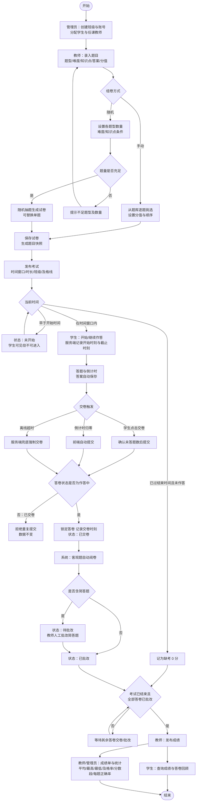
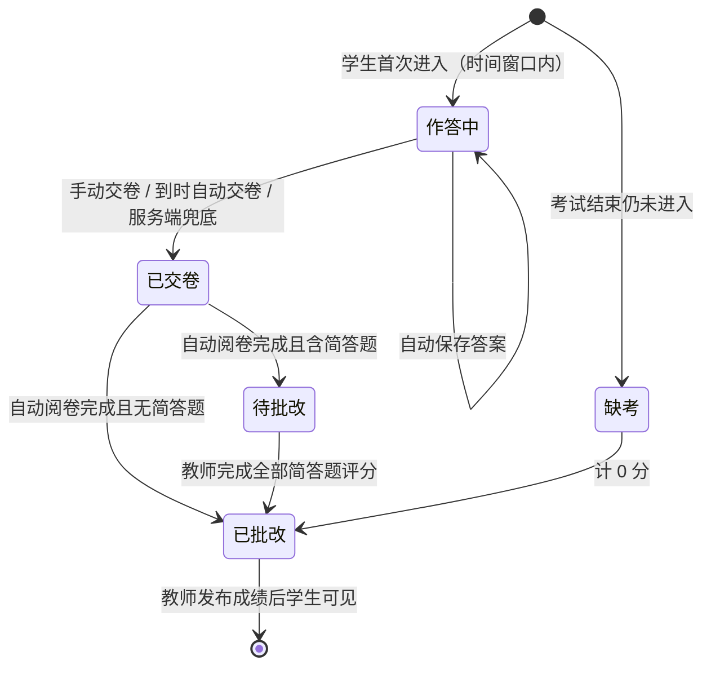

# 在线考试系统 需求规格说明书

| 项目 | 内容 |
| --- | --- |
| 文档版本 | V1.0 |
| 编写角色 | 需求分析师 |
| 下游使用者 | 系统架构师、前后端开发者、测试工程师、论文撰写者、答辩助手 |
| 统计 | 功能需求 33 条（P0 29 条 / P1 2 条 / P2 2 条），非功能需求 15 条 |

---

## 1 引言

### 1.1 背景

高校日常教学中，随堂测验、期中/期末考试大多仍采用纸质试卷：教师命题、排版、印刷、监考、阅卷、登分、统计全靠手工，存在以下痛点：

1. **组卷效率低**：题目散落在个人文档中，无法按题型、难度、知识点复用和抽取；
2. **阅卷工作量大**：客观题需逐份人工核对，容易出错；
3. **统计分析薄弱**：平均分、及格率、分数段、每题正确率等需要手工计算，难以及时反馈教学；
4. **组织成本高**：需要固定考场、纸张印刷与回收，小规模测验难以高频开展。

在线考试系统将“题库—组卷—考试—阅卷—统计”全流程搬到浏览器中，能够显著降低教师工作量，并为教学改进提供数据支撑。本课题面向本科毕业设计规模，实现一个功能完整、结构清晰、可部署运行的轻量级在线考试系统。

### 1.2 目的

本文档用于：

- 明确系统的功能边界、角色权限与业务流程，作为系统设计、编码实现、测试验收的唯一需求依据；
- 为每条需求分配唯一编号，便于在《需求追踪矩阵》中追踪“需求 → 设计 → 接口 → 测试”的对应关系；
- 为毕业论文“需求分析”章节提供素材。

### 1.3 范围

**纳入范围：**

- 用户认证与会话管理；管理员对用户、班级的管理；
- 题库管理：单选、多选、判断、填空、简答五种题型，支持难度与知识点标签；
- 组卷：手动选题、按题型数量（可附加难度/知识点条件）随机抽题；
- 考试发布：时间窗口、考试时长、指定班级、及格线；
- 在线答题：倒计时、自动保存、到时自动交卷、防止重复提交、刷新/断线后恢复；
- 阅卷：客观题自动判分、简答题教师人工批改；
- 成绩：成绩发布、学生查询、教师查看成绩单与统计分析（平均分、最高/最低分、及格率、分数段分布、每题正确率）。

**不纳入范围：**

- 视频监考、人脸识别、切屏检测等防作弊硬件/生物识别手段；
- 编程题在线判题、公式编辑器、图片/附件题干上传；
- 短信/邮件通知、第三方单点登录；
- 移动端原生 App（仅保证浏览器访问）；
- 多租户、多校区、分布式部署。

### 1.4 术语与缩写

| 术语 | 说明 |
| --- | --- |
| 题目（Question） | 题库中的一道题，包含题型、题干、选项、标准答案、难度、知识点标签、解析 |
| 客观题 | 单选、多选、判断、填空，系统可自动判分 |
| 主观题 | 简答题，需要教师人工评分 |
| 试卷（Paper） | 由若干题目及各题分值组成的有序集合，总分为各题分值之和 |
| 考试（Exam） | 将某份试卷在指定时间窗口内发布给指定班级的一次考试活动 |
| 时间窗口 | 考试允许“开始作答”的时间段 [开始时间, 结束时间] |
| 考试时长 | 学生从开始作答起可用的最长分钟数 |
| 答卷（Submission） | 某学生参加某场考试产生的作答记录，含各题答案、得分与状态 |
| 截止时刻（Deadline） | 某份答卷的最晚交卷时刻 = min(开始作答时刻 + 考试时长, 考试结束时间) |
| 自动交卷 | 到达截止时刻时，由前端主动提交或由服务端强制将答卷置为已交卷 |
| 成绩发布 | 教师确认批改完成后将成绩对学生可见的操作 |
| 及格率 | 得分 ≥ 及格线的已交卷人数 / 已交卷人数 |
| 会话令牌（Token） | 登录成功后服务端签发的随机字符串，用于后续请求的身份识别 |
| RBAC | 基于角色的访问控制（Role-Based Access Control） |
| P0 / P1 / P2 | 优先级：P0 必须实现（核心闭环）；P1 应该实现（重要增强）；P2 可选实现（时间允许时） |

---

## 2 总体描述

### 2.1 产品概述

系统为 B/S 架构的单页 Web 应用：浏览器端负责界面渲染与交互，服务端提供 HTTP JSON 接口并负责鉴权、业务逻辑与数据持久化。系统按角色提供三类工作台：

- **管理员工作台**：用户管理、班级管理、系统数据概览；
- **教师工作台**：题库、试卷、考试、阅卷、成绩与统计；
- **学生工作台**：我的考试、在线答题、我的成绩。

### 2.2 用户角色

| 角色 | 描述 | 典型人数（设计参考） |
| --- | --- | --- |
| 管理员 | 系统维护人员，管理账号与班级，不参与命题与考试 | 1~3 |
| 教师 | 命题、组卷、发布考试、批改主观题、查看统计 | 10~50 |
| 学生 | 隶属于一个班级，参加本班考试并查看自己的成绩 | 100~1000 |

系统初始化时内置一个管理员账号（账号 `admin`，初始密码由部署文档给出，首次登录后建议修改）。

### 2.3 权限矩阵

说明：✔ 允许；✘ 禁止；“本人”表示仅限自己创建/所属的数据。

| 功能 | 管理员 | 教师 | 学生 |
| --- | :---: | :---: | :---: |
| 登录 / 退出 / 修改本人密码 | ✔ | ✔ | ✔ |
| 用户管理（增删改查、禁用、重置密码） | ✔ | ✘ | ✘ |
| 班级管理（增删改查、成员分配） | ✔ | 查看本人任课班级 | 查看本人所在班级 |
| 题库管理（题目增删改查、标签） | ✘ | ✔（本人题目） | ✘ |
| 组卷（手动/随机）、试卷管理 | ✘ | ✔（本人试卷） | ✘ |
| 发布 / 编辑 / 取消考试 | ✘ | ✔（本人考试，限任课班级） | ✘ |
| 查看可参加的考试列表 | ✘ | ✘ | ✔（本班考试） |
| 在线答题、自动保存、交卷 | ✘ | ✘ | ✔（本人答卷） |
| 客观题自动阅卷 | 系统自动 | 系统自动 | 系统自动 |
| 简答题人工批改 | ✘ | ✔（本人考试） | ✘ |
| 发布成绩 | ✘ | ✔（本人考试） | ✘ |
| 查看成绩单与统计分析 | ✔（只读，全部考试） | ✔（本人考试） | ✘ |
| 查询本人成绩与答卷回顾 | ✘ | ✘ | ✔（成绩已发布后） |
| 系统数据概览 | ✔ | ✘ | ✘ |

### 2.4 运行环境

| 类别 | 要求 |
| --- | --- |
| 服务端 | Node.js 18 LTS 及以上版本；仅使用 Node.js 内置模块，无需安装任何第三方包；Windows / Linux / macOS 均可运行 |
| 数据存储 | 服务端本地文件系统中的 JSON 文件；存储访问层与业务逻辑分离，可替换为关系型数据库 |
| 客户端 | 桌面浏览器：Chrome / Edge / Firefox 最近两个大版本；屏幕宽度 ≥ 1280px 为主要适配目标，≥ 375px 时答题页面可正常使用 |
| 网络 | 校园局域网或公网，HTTP 协议（生产部署建议置于 HTTPS 反向代理之后） |

### 2.5 假设与约束

**约束：**

1. C-01 服务端仅使用运行时内置能力（HTTP、文件系统、加密等），零第三方依赖；
2. C-02 前端为原生 JavaScript 单页应用，不依赖任何前端框架或 UI 库，不使用构建工具；
3. C-03 数据持久化采用 JSON 文件，单进程部署；
4. C-04 前后端通过 JSON 格式的 HTTP 接口通信，接口契约由系统架构师统一定义；
5. C-05 需求规模须保证团队在一次开发会话内可完成，P0 功能构成最小可演示闭环。

**假设：**

1. A-01 一名学生只属于一个班级；一名教师可任教多个班级，一个班级可有多名任课教师；
2. A-02 同一场考试每名学生仅允许作答一次（不支持补考/重考，P2 之外不考虑）；
3. A-03 考试时间以服务端时钟为准，客户端时间仅用于显示；
4. A-04 填空题采用“标准答案文本比对”判分（去除首尾空格、忽略英文大小写，一空可配置多个可接受答案）；
5. A-05 多选题判分规则：与标准答案完全一致得满分，少选/错选/多选均得 0 分；
6. A-06 并发规模为单场考试同时在线学生不超过 200 人。

---

## 3 功能需求

### 3.0 模块划分与编号规则

| 模块代号 | 模块名称 | 条数 |
| --- | --- | --- |
| AUTH | 认证与会话 | 3 |
| USER | 用户管理 | 3 |
| CLASS | 班级管理 | 2 |
| QB | 题库管理 | 5 |
| PAPER | 组卷与试卷管理 | 3 |
| EXAM | 考试发布与管理 | 3 |
| ANS | 在线答题 | 5 |
| GRADE | 阅卷与成绩发布 | 3 |
| STAT | 成绩查询与统计 | 6 |
| **合计** | | **33** |

编号格式：`FR-模块代号-两位序号`。每条需求按“描述 / 输入 / 处理 / 输出 / 所属角色 / 优先级”描述。

---

### 3.1 认证与会话（AUTH）

#### FR-AUTH-01 用户登录

- **描述**：用户使用账号和密码登录系统，登录后根据角色进入对应工作台。
- **输入**：账号（用户名/学号/工号）、密码。
- **处理**：
  1. 校验账号、密码非空；
  2. 查找用户，不存在或密码哈希比对失败时统一提示“账号或密码错误”（不区分具体原因）；
  3. 账号被禁用时拒绝登录并提示“账号已被禁用”；
  4. 校验通过后生成随机会话令牌，记录令牌、用户 ID、过期时间；
  5. 同一账号连续 5 次密码错误后锁定 10 分钟（见 NFR-05）。
- **输出**：成功返回令牌、用户基本信息（ID、姓名、角色、班级）；前端保存令牌并跳转到对应角色首页。失败返回错误码与提示。
- **所属角色**：管理员、教师、学生
- **优先级**：P0

#### FR-AUTH-02 退出登录与会话校验

- **描述**：用户可主动退出；所有受保护接口都需校验会话有效性；前端刷新页面后可凭令牌恢复登录态。
- **输入**：请求携带的会话令牌。
- **处理**：
  1. 退出：服务端立即使该令牌失效；
  2. 校验：令牌不存在、已过期或对应用户已禁用时返回“未登录”错误；
  3. 提供“获取当前用户信息”能力供前端刷新后恢复登录态；
  4. 会话有效期内每次有效访问自动续期（滑动过期）。
- **输出**：退出成功提示并跳转登录页；校验失败时前端清除本地令牌并跳转登录页。
- **所属角色**：管理员、教师、学生
- **优先级**：P0

#### FR-AUTH-03 修改本人密码

- **描述**：已登录用户修改自己的密码。
- **输入**：原密码、新密码、确认新密码。
- **处理**：校验原密码正确；新密码长度 6~32 位且须同时包含字母和数字；两次输入一致；新密码不得与原密码相同；以加盐哈希方式保存；修改成功后使该用户除当前会话外的其他会话失效。
- **输出**：修改成功/失败提示。
- **所属角色**：管理员、教师、学生
- **优先级**：P1

---

### 3.2 用户管理（USER）

#### FR-USER-01 用户列表查询

- **描述**：管理员分页查看系统用户，支持筛选。
- **输入**：角色筛选（全部/管理员/教师/学生）、班级筛选、关键字（账号或姓名模糊匹配）、状态（启用/禁用）、页码、每页条数（默认 10）。
- **处理**：按条件过滤、按创建时间倒序、分页；返回结果中不得包含密码哈希与盐值。
- **输出**：用户列表（账号、姓名、角色、所属班级、状态、创建时间）及总条数。
- **所属角色**：管理员
- **优先级**：P0

#### FR-USER-02 新增用户

- **描述**：管理员创建教师或学生账号。
- **输入**：账号、姓名、角色（教师/学生/管理员）、初始密码（可留空，留空时使用默认初始密码）、所属班级（学生必填）。
- **处理**：校验账号唯一（4~20 位字母、数字、下划线）、姓名非空（≤20 字）；学生必须指定存在的班级；密码加盐哈希存储；默认状态为“启用”。
- **输出**：新增成功后返回用户信息并刷新列表；失败返回具体字段错误（如“账号已存在”）。
- **所属角色**：管理员
- **优先级**：P0

#### FR-USER-03 编辑、禁用/启用、重置密码、删除用户

- **描述**：管理员维护已有用户。
- **输入**：用户 ID；可修改字段（姓名、所属班级、状态）；或重置密码操作；或删除操作。
- **处理**：
  1. 账号与角色创建后不可修改；
  2. 禁用后该用户所有会话立即失效且无法登录；
  3. 重置密码将密码设为默认初始密码并使其会话失效；
  4. 删除：已产生答卷的学生、已创建题目/考试的教师不允许物理删除，只能禁用；管理员不能禁用或删除自己。
- **输出**：操作结果提示，列表刷新。
- **所属角色**：管理员
- **优先级**：P0（编辑/禁用/重置密码）；删除为 P1，随本条一并实现

---

### 3.3 班级管理（CLASS）

#### FR-CLASS-01 班级增删改查

- **描述**：管理员维护班级信息。
- **输入**：班级名称（如“计科 2101”）、年级、专业、备注；查询关键字。
- **处理**：班级名称全局唯一；班级下仍有学生或存在关联考试时不允许删除；列表显示学生人数与任课教师。
- **输出**：班级列表（名称、年级、专业、学生人数、任课教师）；操作结果提示。
- **所属角色**：管理员（增删改）；教师（只读，本人任课班级）
- **优先级**：P0

#### FR-CLASS-02 班级成员管理

- **描述**：管理员为班级分配学生与任课教师。
- **输入**：班级 ID；待加入/移出的学生 ID 列表；任课教师 ID 列表。
- **处理**：学生只能属于一个班级，加入新班级时自动从原班级移出（需二次确认）；任课教师可多选；教师只能向本人任课班级发布考试（见 FR-EXAM-01）。
- **输出**：班级成员列表（学生名单、任课教师名单）。
- **所属角色**：管理员
- **优先级**：P0

---

### 3.4 题库管理（QB）

#### FR-QB-01 新增题目（五种题型）

- **描述**：教师向本人题库录入题目，支持单选、多选、判断、填空、简答五种题型。
- **输入**：
  - 公共字段：题型、题干（1~2000 字）、难度（简单/中等/困难）、知识点标签（0~5 个）、默认分值（正数，最多 1 位小数）、解析（可选）；
  - 单选/多选：选项列表（2~8 个，按 A、B、C… 编号）、正确选项（单选恰好 1 个；多选至少 2 个）；
  - 判断：正确答案（对/错）；
  - 填空：题干中用 `___`（三个下划线）标记空位，每空一个或多个可接受答案（以 `|` 分隔）；空位数须与答案组数一致；
  - 简答：参考答案（供批改参考，可选）。
- **处理**：按题型做结构校验；记录创建人和创建时间；题目归属创建教师。
- **输出**：新增成功提示，题目出现在题库列表中。
- **所属角色**：教师
- **优先级**：P0

#### FR-QB-02 编辑与删除题目

- **描述**：教师修改或删除本人题目。
- **输入**：题目 ID、修改后的字段。
- **处理**：仅允许操作本人创建的题目；题目已被试卷引用时允许编辑，但已组成的试卷保留组卷时的题目快照（见 FR-PAPER-01），不受后续修改影响；已被试卷引用的题目删除时提示“该题已被 N 份试卷引用”，确认后执行逻辑删除（不再出现在题库与选题列表中）。
- **输出**：操作结果提示，列表刷新。
- **所属角色**：教师
- **优先级**：P0

#### FR-QB-03 题目检索与筛选

- **描述**：教师按条件分页浏览本人题库。
- **输入**：题型、难度、知识点标签（可多选，命中任一即可）、题干关键字、页码、每页条数。
- **处理**：组合条件过滤，按创建时间倒序分页；同时返回当前筛选条件下按题型、难度的数量汇总，为随机组卷提供参考。
- **输出**：题目列表（题型、题干摘要、难度、标签、默认分值、被引用次数）及汇总数量；点击可查看题目详情。
- **所属角色**：教师
- **优先级**：P0

#### FR-QB-04 知识点标签管理

- **描述**：教师维护本人使用的知识点标签。
- **输入**：标签名称（1~20 字）；重命名/删除操作。
- **处理**：录题时可从已有标签选择或直接新建；同一教师下标签名唯一；重命名时同步更新所有关联题目；删除标签时从关联题目中移除该标签，不删除题目；展示每个标签关联题目数。
- **输出**：标签列表（名称、题目数）。
- **所属角色**：教师
- **优先级**：P1

#### FR-QB-05 题目批量导入

- **描述**：教师上传或粘贴符合约定格式的 JSON 文本批量导入题目。
- **输入**：JSON 文本（题目数组，字段同 FR-QB-01）。
- **处理**：逐条校验，校验通过的导入，失败的记录行号与原因；单次最多 200 题。
- **输出**：导入结果（成功数、失败数、失败明细）。
- **所属角色**：教师
- **优先级**：P2

---

### 3.5 组卷与试卷管理（PAPER）

#### FR-PAPER-01 手动组卷

- **描述**：教师从本人题库中逐题挑选题目组成试卷。
- **输入**：试卷名称、说明（可选）；选中的题目 ID 列表；每题分值（默认取题目默认分值，可修改）；题目顺序。
- **处理**：
  1. 试卷至少包含 1 道题，同一题不得重复加入；
  2. 系统按题型分组（单选→多选→判断→填空→简答）排序，组内可调整顺序；
  3. 自动计算总分与各题型小计；
  4. 保存时将题目内容（题干、选项、答案、分值）以**快照**形式存入试卷，后续题库修改不影响已组试卷。
- **输出**：试卷详情（题目列表、分值、总分、题型统计）。
- **所属角色**：教师
- **优先级**：P0

#### FR-PAPER-02 随机抽题组卷

- **描述**：教师设置各题型抽题数量与每题分值，系统从题库随机抽题生成试卷。
- **输入**：试卷名称；抽题规则列表，每条规则包含：题型、数量、每题分值，可选的难度条件、知识点标签条件。
- **处理**：
  1. 对每条规则，从满足条件且未被已抽中的本人题目中无放回随机抽取指定数量；
  2. 任一规则可用题数不足时，整体失败并提示“XX 题型（条件）仅有 N 道，需 M 道”，不生成残缺试卷；
  3. 生成后进入试卷编辑界面，教师可替换单题（从同条件中重新随机）、删除或手动追加题目后保存；
  4. 保存时同样生成题目快照。
- **输出**：生成的试卷详情（同 FR-PAPER-01）。
- **所属角色**：教师
- **优先级**：P0

#### FR-PAPER-03 试卷列表、预览、编辑与删除

- **描述**：教师管理本人试卷。
- **输入**：试卷 ID、关键字、编辑内容。
- **处理**：列表显示试卷名称、题量、总分、创建时间、被考试引用次数；预览以学生视角展示（可切换显示答案）；已被考试引用的试卷不允许编辑和删除，可“复制为新试卷”后修改。
- **输出**：试卷列表、预览页面、操作结果提示。
- **所属角色**：教师
- **优先级**：P0（列表/预览/删除）；复制为新试卷为 P1，随本条一并实现

---

### 3.6 考试发布与管理（EXAM）

#### FR-EXAM-01 发布考试

- **描述**：教师基于某份试卷发布一场考试。
- **输入**：考试名称、试卷 ID、开始时间、结束时间、考试时长（分钟）、参考班级（一个或多个，限本人任课班级）、及格线（默认总分的 60%）、考试说明（可选）、选项是否乱序（P2，默认否）。
- **处理**：
  1. 校验：结束时间 > 开始时间 > 当前时间；考试时长 ≥ 1 分钟且 ≤ 时间窗口长度；及格线介于 0 与试卷总分之间；
  2. 试卷被引用后锁定不可编辑；
  3. 考试状态由服务端根据当前时间计算：未开始 / 进行中 / 已结束；另有“已取消”状态。
- **输出**：考试信息及状态；参考班级学生在“我的考试”中可见。
- **所属角色**：教师
- **优先级**：P0

#### FR-EXAM-02 考试管理（列表、修改、取消、监控）

- **描述**：教师查看与维护本人发布的考试。
- **输入**：考试 ID；状态筛选；修改字段。
- **处理**：
  1. 列表显示名称、试卷、时间窗口、时长、班级、状态、应考人数、已交卷人数、待批改人数、成绩是否已发布；
  2. “未开始”的考试可修改全部字段或取消；“进行中”的考试仅可延长结束时间；“已结束”的考试不可修改；
  3. 进行中可查看作答监控：每名学生状态（未开始/作答中/已交卷）及开始、交卷时间。
- **输出**：考试列表与详情、监控列表、操作结果提示。
- **所属角色**：教师
- **优先级**：P0（列表/取消/监控）；修改与延长为 P1，随本条一并实现

#### FR-EXAM-03 学生考试列表

- **描述**：学生查看本班的考试。
- **输入**：状态筛选（全部/未开始/可参加/已完成/已错过）。
- **处理**：仅返回学生所在班级、且未取消的考试；根据当前时间与本人答卷状态计算显示状态与可执行操作：未开始（显示倒计时，不可进入）、可参加（开始/继续作答）、已交卷（等待成绩/查看成绩）、已错过（时间窗口结束且未作答，记 0 分）。
- **输出**：考试卡片列表（名称、时间窗口、时长、总分、题量、状态、操作按钮）。
- **所属角色**：学生
- **优先级**：P0

---

### 3.7 在线答题（ANS）

#### FR-ANS-01 开始/继续作答

- **描述**：学生在考试时间窗口内开始作答，或在中断后继续作答。
- **输入**：考试 ID。
- **处理**：
  1. 校验：学生属于参考班级；当前时间在时间窗口内；考试未取消；本人不存在“已交卷”答卷；
  2. 首次进入时创建答卷，记录服务端开始时刻，计算截止时刻 = min(开始时刻 + 考试时长, 考试结束时间)；
  3. 再次进入（刷新/断线/换浏览器）时返回已有答卷与已保存答案，**不重置开始时刻**；
  4. 返回给学生的题目数据**不得包含**标准答案、参考答案与解析。
- **输出**：试卷题目（不含答案）、已保存答案、服务端当前时间、截止时刻。
- **所属角色**：学生
- **优先级**：P0

#### FR-ANS-02 答题界面与倒计时

- **描述**：提供便捷的答题界面与剩余时间倒计时。
- **输入**：FR-ANS-01 返回的数据；学生作答操作。
- **处理**：
  1. 按题型分区展示题目，单选用单选框、多选用复选框、判断用“对/错”、填空每空一个输入框、简答用多行文本框（≤2000 字）；
  2. 提供答题卡导航：显示题号，已答/未答/标记题以不同样式区分，点击跳转；
  3. 倒计时 = 截止时刻 −（服务端时间 + 本地流逝时间），每秒刷新，以“时:分:秒”显示；剩余 5 分钟时醒目提示一次；
  4. 支持“标记本题”以便回看。
- **输出**：答题页面、实时剩余时间。
- **所属角色**：学生
- **优先级**：P0

#### FR-ANS-03 自动保存答案

- **描述**：学生作答过程中答案自动保存到服务端，防止意外丢失。
- **输入**：考试/答卷 ID、变更的题目答案。
- **处理**：
  1. 触发时机：选项变更后立即保存；文本输入停止 2 秒后保存；另每 30 秒兜底保存一次；
  2. 服务端校验答卷属于本人、状态为“作答中”、当前时间未超过截止时刻（允许 10 秒网络宽限），否则拒绝；
  3. 保存失败时前端提示“保存失败，正在重试”并在本地暂存，网络恢复后重试；
  4. 界面显示最后保存时间。
- **输出**：保存成功（返回保存时间）或失败原因。
- **所属角色**：学生
- **优先级**：P0

#### FR-ANS-04 手动交卷与防重复提交

- **描述**：学生主动交卷，系统保证每份答卷只被提交一次。
- **输入**：答卷 ID、最终答案。
- **处理**：
  1. 交卷前弹窗确认，提示未答题数量；
  2. 提交时按钮置为不可用，防止重复点击；
  3. 服务端以答卷状态为准做幂等处理：状态为“作答中”时保存最终答案、记录交卷时刻、状态置为“已交卷”并立即触发客观题自动阅卷（FR-GRADE-01）；状态已为“已交卷”时不再修改任何数据，返回“已交卷，请勿重复提交”；
  4. 交卷后再次进入答题页面将被拒绝并跳转结果页。
- **输出**：交卷成功提示；成绩未发布时显示“已交卷，等待成绩发布”。
- **所属角色**：学生
- **优先级**：P0

#### FR-ANS-05 到时自动交卷

- **描述**：到达截止时刻时，系统自动为学生交卷，不依赖学生操作。
- **输入**：截止时刻；答卷当前已保存答案。
- **处理**：
  1. 前端：倒计时归零时自动提交当前答案（不再弹确认），提示“考试时间到，已自动交卷”；
  2. 服务端兜底：对已超过截止时刻仍为“作答中”的答卷（如学生关闭浏览器），在下次访问该考试相关数据时或由定时检查（不低于每分钟一次）将其以最后保存的答案强制交卷，并记录交卷方式为“超时自动交卷”；
  3. 考试结束后，参考班级中从未开始作答的学生生成“缺考”记录，计 0 分。
- **输出**：答卷状态变为已交卷（交卷方式：手动/自动/缺考）。
- **所属角色**：学生（系统自动执行）
- **优先级**：P0

---

### 3.8 阅卷与成绩发布（GRADE）

#### FR-GRADE-01 客观题自动阅卷

- **描述**：交卷后系统立即对客观题自动判分。
- **输入**：答卷答案、试卷快照中的标准答案与分值。
- **处理**：
  1. 单选、判断：与标准答案一致得满分，否则 0 分；
  2. 多选：选项集合与标准答案完全一致得满分，否则 0 分；
  3. 填空：逐空比对（去首尾空格、忽略英文大小写），命中该空任一可接受答案即得分，每空分值 = 题目分值 / 空数（保留 1 位小数，余数计入最后一空）；
  4. 未作答得 0 分；
  5. 计算客观题总分；若试卷不含简答题，答卷状态直接置为“已批改”，否则置为“待批改”。
- **输出**：每题得分与是否正确、客观题得分、答卷批改状态。
- **所属角色**：系统（自动）
- **优先级**：P0

#### FR-GRADE-02 简答题人工批改

- **描述**：教师对待批改答卷中的简答题逐份评分。
- **输入**：考试 ID；批改方式（按学生逐份 / 按题目逐题）；每道简答题得分、评语（可选）。
- **处理**：
  1. 仅考试创建教师可批改；批改界面展示题干、参考答案、学生答案；
  2. 得分须在 0 至该题分值之间，最多 1 位小数；
  3. 显示批改进度（已批 / 总数），支持“保存并下一份”；
  4. 一份答卷的所有简答题均已评分后，计算总分 = 客观题得分 + 主观题得分，状态置为“已批改”；
  5. 成绩发布前可修改已批分数。
- **输出**：批改结果、答卷总分、批改进度。
- **所属角色**：教师
- **优先级**：P0

#### FR-GRADE-03 发布成绩

- **描述**：教师确认后将考试成绩对学生公开。
- **输入**：考试 ID；是否允许学生查看答案与解析（默认允许）。
- **处理**：仅当考试已结束且所有已交卷答卷均为“已批改”时允许发布，否则提示剩余待批改份数；发布后学生可查看成绩；发布后如需修改分数须先“撤回发布”（P1）。
- **输出**：考试成绩状态变为“已发布”。
- **所属角色**：教师
- **优先级**：P0

---

### 3.9 成绩查询与统计（STAT）

#### FR-STAT-01 学生成绩查询与答卷回顾

- **描述**：学生查看本人已发布成绩的考试成绩及答卷详情。
- **输入**：考试 ID（列表查询时无需输入）。
- **处理**：仅返回本人答卷；成绩未发布时只显示“已交卷，待发布”；成绩发布后显示总分、是否及格、客观/主观得分；若教师允许，显示每题本人答案、正确答案、得分、解析与评语。
- **输出**：我的成绩列表（考试名称、交卷时间、得分/总分、是否及格）与答卷回顾页。
- **所属角色**：学生
- **优先级**：P0

#### FR-STAT-02 教师成绩单

- **描述**：教师查看某场考试的全部学生成绩。
- **输入**：考试 ID；班级筛选；排序方式（总分降序/学号升序）。
- **处理**：列出参考班级全部学生，包括缺考者；显示学号、姓名、班级、交卷方式、交卷时间、客观分、主观分、总分、排名、是否及格；可点击查看任一学生答卷详情。
- **输出**：成绩单表格。
- **所属角色**：教师（本人考试）、管理员（只读）
- **优先级**：P0

#### FR-STAT-03 考试成绩概要统计

- **描述**：对一场考试计算核心统计指标。
- **输入**：考试 ID；班级筛选（全部/某班级）。
- **处理**：以已交卷且已批改的答卷为统计对象（缺考单独计数，不计入平均分），计算：应考人数、实考人数、缺考人数、平均分（保留 2 位小数）、最高分、最低分、及格人数、及格率（百分比，保留 1 位小数）；多班级时提供各班对比。
- **输出**：统计指标卡片及班级对比表。
- **所属角色**：教师（本人考试）、管理员（只读）
- **优先级**：P0

#### FR-STAT-04 分数段分布

- **描述**：展示成绩分数段分布。
- **输入**：考试 ID；班级筛选。
- **处理**：按得分率划分 5 段：[0,60%)、[60%,70%)、[70%,80%)、[80%,90%)、[90%,100%]（以试卷总分为基准），统计各段人数与占比。
- **输出**：分数段表格及柱状图（前端原生绘制）。
- **所属角色**：教师（本人考试）、管理员（只读）
- **优先级**：P0

#### FR-STAT-05 每题正确率分析

- **描述**：统计每道题的作答情况，辅助教学分析。
- **输入**：考试 ID；班级筛选。
- **处理**：
  1. 客观题：正确率 = 得满分人数 / 实考人数；单选/多选额外统计各选项选择人数；
  2. 简答题：得分率 = 平均得分 / 题目分值；
  3. 支持按正确率升序排列以快速定位难题；同时显示题目难度与知识点标签。
- **输出**：题目分析表（题号、题型、题干摘要、难度、知识点、正确率/得分率、选项分布）。
- **所属角色**：教师（本人考试）、管理员（只读）
- **优先级**：P0

#### FR-STAT-06 成绩导出与系统概览

- **描述**：教师将成绩单导出为 CSV 文件；管理员查看系统数据概览。
- **输入**：考试 ID（导出）；无（概览）。
- **处理**：导出内容同 FR-STAT-02 表格列，UTF-8 带 BOM 以便表格软件正确识别中文；概览统计用户数（按角色）、班级数、题目数、试卷数、考试数（按状态）。
- **输出**：CSV 文件下载；概览数据卡片。
- **所属角色**：教师（导出）、管理员（概览）
- **优先级**：P2

---

### 3.10 功能需求汇总

| 优先级 | 数量 | 编号 |
| --- | --- | --- |
| P0 | 29 | FR-AUTH-01、FR-AUTH-02、FR-USER-01、FR-USER-02、FR-USER-03、FR-CLASS-01、FR-CLASS-02、FR-QB-01、FR-QB-02、FR-QB-03、FR-PAPER-01、FR-PAPER-02、FR-PAPER-03、FR-EXAM-01、FR-EXAM-02、FR-EXAM-03、FR-ANS-01、FR-ANS-02、FR-ANS-03、FR-ANS-04、FR-ANS-05、FR-GRADE-01、FR-GRADE-02、FR-GRADE-03、FR-STAT-01、FR-STAT-02、FR-STAT-03、FR-STAT-04、FR-STAT-05 |
| P1 | 2 | FR-AUTH-03、FR-QB-04 |
| P2 | 2 | FR-QB-05、FR-STAT-06 |

> 注：共 33 条。部分 P0 条目内含 P1 子功能（FR-USER-03 删除、FR-PAPER-03 复制、FR-EXAM-02 修改/延长、FR-GRADE-03 撤回发布），实现时可后置。

---

## 4 非功能需求

每条非功能需求均给出可验证的验收方法。

### 4.1 性能

| 编号 | 名称 | 需求描述 | 验证方法 |
| --- | --- | --- | --- |
| NFR-01 | 接口响应时间 | 在数据量为 1000 名用户、2000 道题目、100 场考试、5000 份答卷时，单请求普通查询接口平均响应时间 ≤ 300ms，统计类接口 ≤ 1s（本机部署，不含网络延迟） | 使用脚本生成上述规模测试数据，循环调用各接口 100 次统计平均耗时 |
| NFR-02 | 并发答题 | 200 名学生同时在线答题，每人每 30 秒保存一次答案、并在 1 分钟内集中交卷时，保存/交卷请求成功率 100%，无答卷数据丢失或互相覆盖 | 编写并发脚本模拟 200 个会话并发保存与交卷，核对每份答卷内容与提交内容一致 |
| NFR-03 | 首屏加载 | 前端单页首屏静态资源总大小 ≤ 300KB，局域网环境下首屏可交互时间 ≤ 2s | 浏览器开发者工具网络面板统计资源大小与加载时间 |

### 4.2 安全

| 编号 | 名称 | 需求描述 | 验证方法 |
| --- | --- | --- | --- |
| NFR-04 | 密码加盐哈希存储 | 密码不得以明文或可逆加密形式存储、传输回前端或写入日志；每个用户使用独立的随机盐（≥16 字节），采用慢哈希算法（如 PBKDF2 / scrypt，迭代或代价参数满足单次计算 ≥ 10ms）；比对采用常量时间比较 | 检查数据文件中用户记录仅含哈希与盐；两个相同密码的用户哈希值不同；单元测试验证哈希/校验函数 |
| NFR-05 | 会话令牌与登录防护 | 会话令牌由密码学安全随机数生成（≥32 字节，十六进制或 Base64 编码），通过请求头携带，不出现在 URL 中；令牌空闲 2 小时过期；退出、禁用、改密后令牌立即失效；同一账号连续 5 次密码错误锁定 10 分钟 | 测试用例：过期令牌、已退出令牌、伪造令牌访问受保护接口均返回 401；连续 5 次错误密码后正确密码也被拒绝 |
| NFR-06 | 越权校验 | 所有接口在服务端执行两级校验：① 角色校验（RBAC，按 2.3 权限矩阵）；② 数据归属校验（教师只能操作本人题目/试卷/考试和任课班级，学生只能访问本班考试与本人答卷）。前端隐藏按钮不能替代服务端校验。越权返回 403，不泄露资源是否存在之外的信息 | 测试用例：学生调用教师/管理员接口；教师 A 修改教师 B 的题目、批改教师 B 的考试；学生 A 读取或保存学生 B 的答卷；学生进入非本班考试，均返回 403 |
| NFR-07 | 防重复交卷与考试时间防篡改 | 交卷接口幂等：同一答卷并发或重复提交 N 次，仅第一次生效，答卷只有一条且交卷时间不变；作答开始时刻、截止时刻、交卷时刻均以服务端时间计算，修改客户端系统时间或请求参数无法延长作答时间；截止时刻 + 10 秒宽限后保存/交卷请求的新答案不被接受 | 测试用例：并发 10 次提交同一答卷；交卷后再保存答案；超时后提交；篡改本地时间后观察倒计时与服务端拒绝行为 |
| NFR-08 | 答案保密 | 考试作答期间，学生端可获取的任何接口响应中不得包含标准答案、参考答案、解析；成绩发布前学生不能看到得分 | 抓取学生端全部接口响应，搜索答案字段，结果为空 |
| NFR-09 | 输入校验与 XSS 防护 | 服务端对所有输入做类型、长度、枚举校验，非法输入返回 400 及字段级错误信息；请求体大小上限 1MB；前端渲染用户输入内容（题干、答案、姓名等）时一律按文本转义，不得作为 HTML 执行；静态资源服务禁止路径穿越访问项目外文件 | 测试用例：题干录入 `` 后在各页面原样显示为文本；请求 `/../` 路径被拒绝；超长/非法字段返回 400 |

### 4.3 可靠性与可用性

| 编号 | 名称 | 需求描述 | 验证方法 |
| --- | --- | --- | --- |
| NFR-10 | 数据持久化可靠性 | JSON 文件写入采用“写临时文件后原子重命名”方式，进程在写入过程中被强制终止不会产生损坏的数据文件；同一数据文件的写操作串行化，避免并发写覆盖；服务重启后数据完整恢复 | 在高频写入过程中强杀进程后重启，数据文件可正常解析；并发写测试无数据丢失 |
| NFR-11 | 作答断点恢复 | 学生在作答期间刷新页面、关闭重开浏览器或短暂断网（≤ 截止时刻）后，重新进入可恢复全部已保存答案，剩余时间按服务端时间连续计算而非重置；最多丢失最近 2 秒内未保存的文本输入 | 作答中刷新、断网 1 分钟后恢复、换浏览器登录，核对答案与剩余时间 |
| NFR-12 | 易用性 | 界面中文；各角色核心操作（学生开始考试、教师发布考试）从首页出发 ≤ 3 次点击可达；所有表单提交有加载状态与成功/失败提示，错误提示指明具体字段；危险操作（删除、交卷、取消考试）需二次确认；未登录访问任何页面自动跳转登录页 | 按测试脚本逐项走查，记录点击次数与提示文案 |

### 4.4 可维护性

| 编号 | 名称 | 需求描述 | 验证方法 |
| --- | --- | --- | --- |
| NFR-13 | 分层与可替换存储 | 服务端代码分为路由/控制层、业务服务层、数据访问层；业务层不直接读写文件；数据访问层以统一接口封装，替换为关系型数据库时只需新增一个数据访问实现而无需改动业务层；统一错误响应格式（错误码 + 提示信息）；配置项（端口、数据目录、会话有效期）集中管理 | 代码评审检查目录结构与调用关系；检查业务层源码中无文件系统调用 |
| NFR-14 | 可测试性 | 核心业务逻辑（判分、随机组卷、统计计算、权限校验、交卷幂等）具备自动化测试，可通过一条命令运行，使用运行时内置测试能力；核心业务模块语句覆盖率 ≥ 80%；提供初始化脚本一键生成演示数据（管理员、2 名教师、2 个班级、≥20 名学生、≥30 道题、≥1 场考试） | 执行测试命令全部通过并输出覆盖率；执行初始化脚本后可直接演示 |

### 4.5 兼容性

| 编号 | 名称 | 需求描述 | 验证方法 |
| --- | --- | --- | --- |
| NFR-15 | 运行与浏览器兼容性 | 服务端在 Node.js 18 及以上版本、Windows/Linux/macOS 上无需安装任何依赖即可启动（启动命令一条）；前端在 Chrome、Edge、Firefox 最近两个大版本中功能一致、布局无错乱；1280px 及以上宽度完整显示，答题页在 375px 宽度下可正常作答 | 在三种浏览器中执行冒烟测试；在 Node.js 18 与最新 LTS 上分别启动并运行测试 |

---

## 5 业务流程

### 5.1 考试全生命周期文字描述

1. **准备阶段（管理员）**：管理员创建班级，录入教师与学生账号，将学生分配到班级，并为班级指定任课教师（FR-USER-02、FR-CLASS-01、FR-CLASS-02）。
2. **创建题目（教师）**：教师录入题目，设置题型、难度、知识点标签、分值与答案（FR-QB-01 ~ FR-QB-04）。
3. **组卷（教师）**：教师选择手动组卷，或设置各题型数量规则随机抽题；系统校验题量充足后生成试卷，并保存题目快照（FR-PAPER-01 ~ FR-PAPER-03）。
4. **发布考试（教师）**：教师选择试卷，设置时间窗口、时长、参考班级与及格线后发布；考试状态随时间由“未开始”变为“进行中”（FR-EXAM-01、FR-EXAM-02）。
5. **学生作答（学生）**：学生在“我的考试”中看到考试，在时间窗口内进入作答；系统创建答卷并按服务端时间计算截止时刻；作答过程中答案自动保存，刷新/断线可恢复（FR-EXAM-03、FR-ANS-01 ~ FR-ANS-03）。
6. **交卷（学生/系统）**：学生手动交卷（确认 + 幂等防重复），或倒计时归零时前端自动交卷；若学生离线，服务端在截止后兜底强制交卷；考试结束后未参加者记为缺考（FR-ANS-04、FR-ANS-05）。
7. **自动阅卷（系统）**：交卷后立即对客观题判分；无简答题的答卷直接完成批改，否则进入“待批改”（FR-GRADE-01）。
8. **人工批改（教师）**：教师对简答题逐份或逐题评分，全部评分后计算总分（FR-GRADE-02）。
9. **发布成绩（教师）**：考试结束且全部答卷批改完成后，教师发布成绩；学生可查询成绩与答卷回顾（FR-GRADE-03、FR-STAT-01）。
10. **统计分析（教师/管理员）**：查看成绩单、平均分、最高/最低分、及格率、分数段分布、每题正确率，并可导出（FR-STAT-02 ~ FR-STAT-06）。

### 5.2 考试全生命周期流程图

### 5.3 答卷状态转换

### 5.4 考试状态说明

| 状态 | 判定条件 | 教师可执行操作 | 学生可执行操作 |
| --- | --- | --- | --- |
| 未开始 | 当前时间 < 开始时间 | 修改、取消 | 查看信息 |
| 进行中 | 开始时间 ≤ 当前时间 ≤ 结束时间 | 延长结束时间、作答监控、批改已交卷答卷 | 开始/继续作答、交卷 |
| 已结束 | 当前时间 > 结束时间 | 批改、发布成绩、统计 | 等待成绩 / 查看成绩 |
| 已取消 | 教师在未开始时取消 | 无 | 不可见 |
