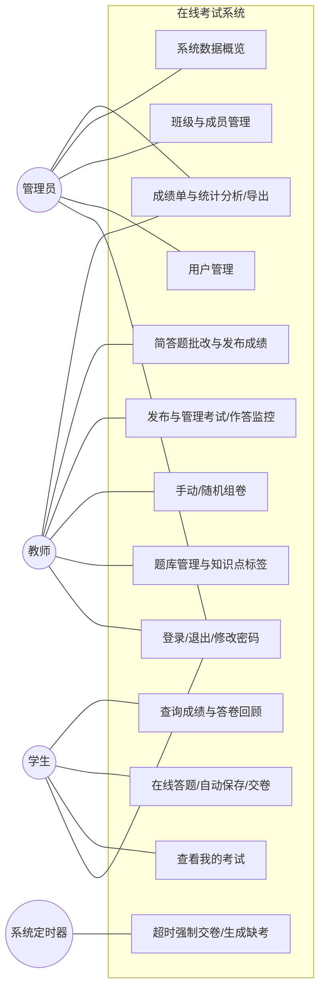
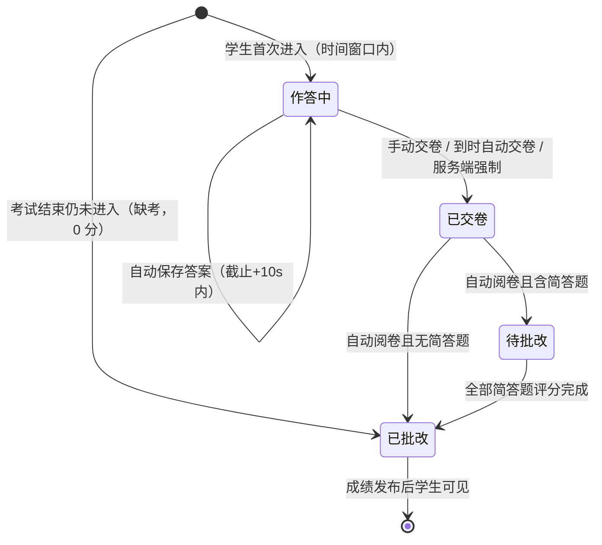
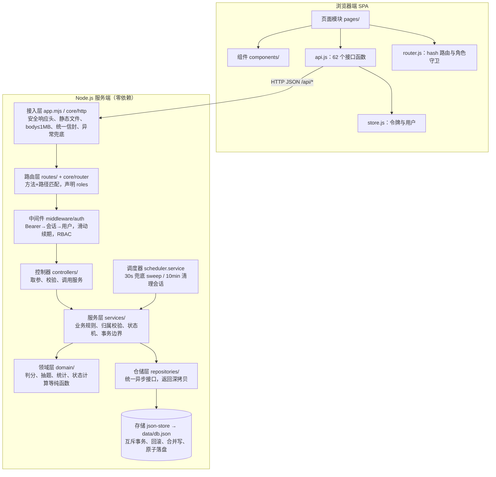
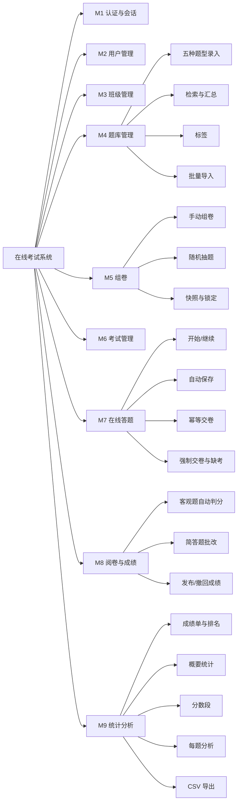
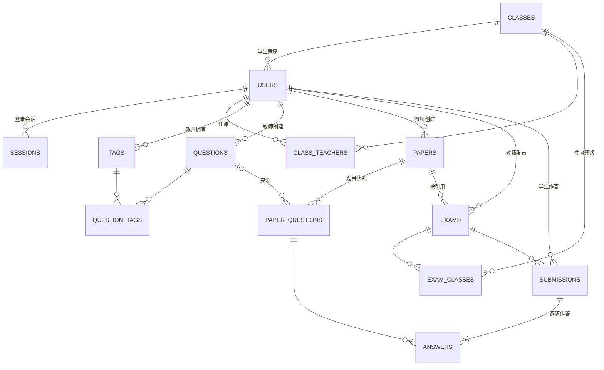
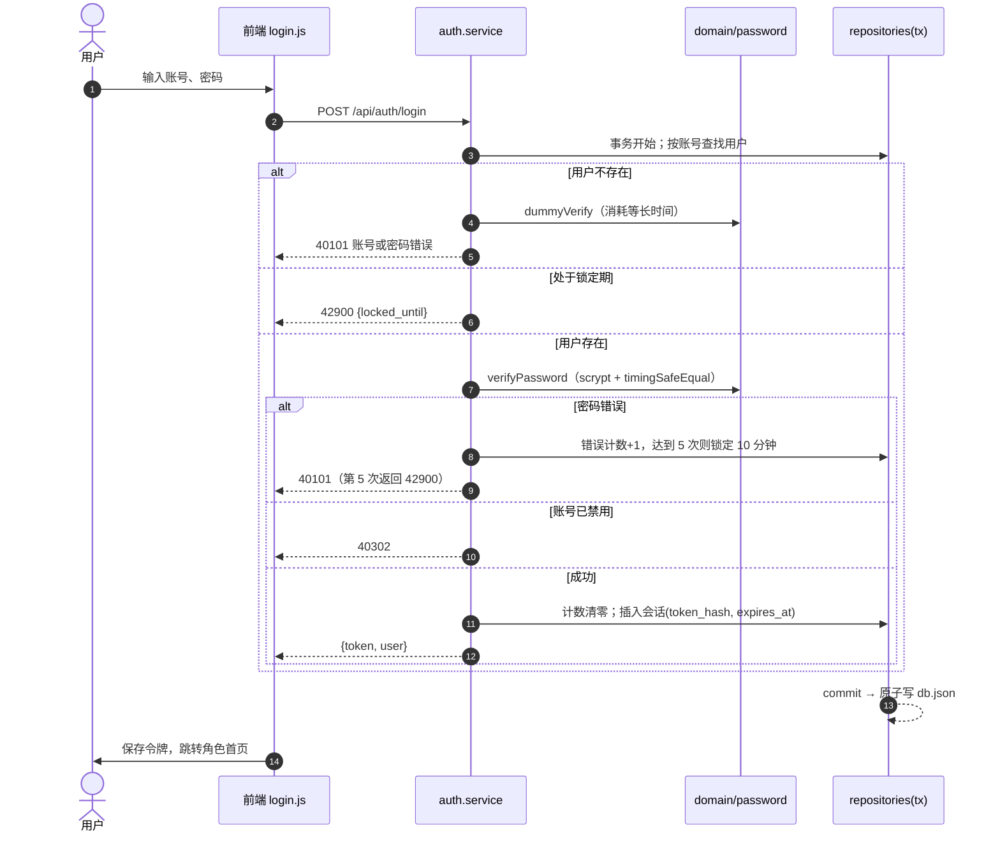
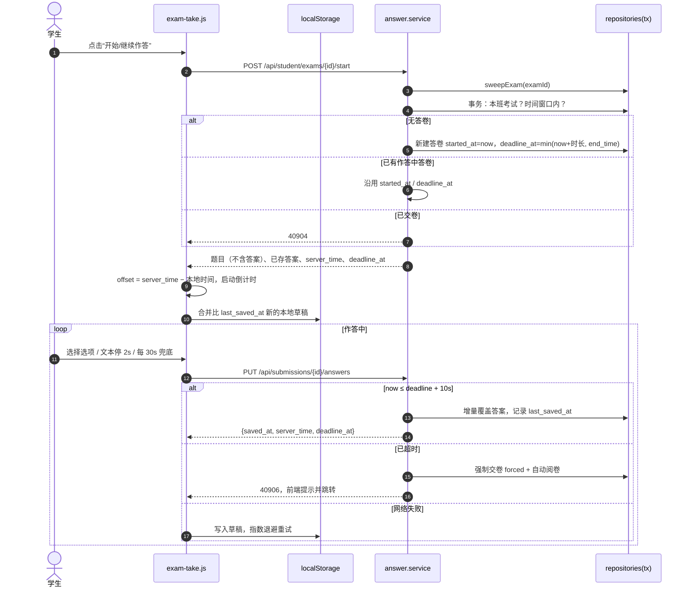
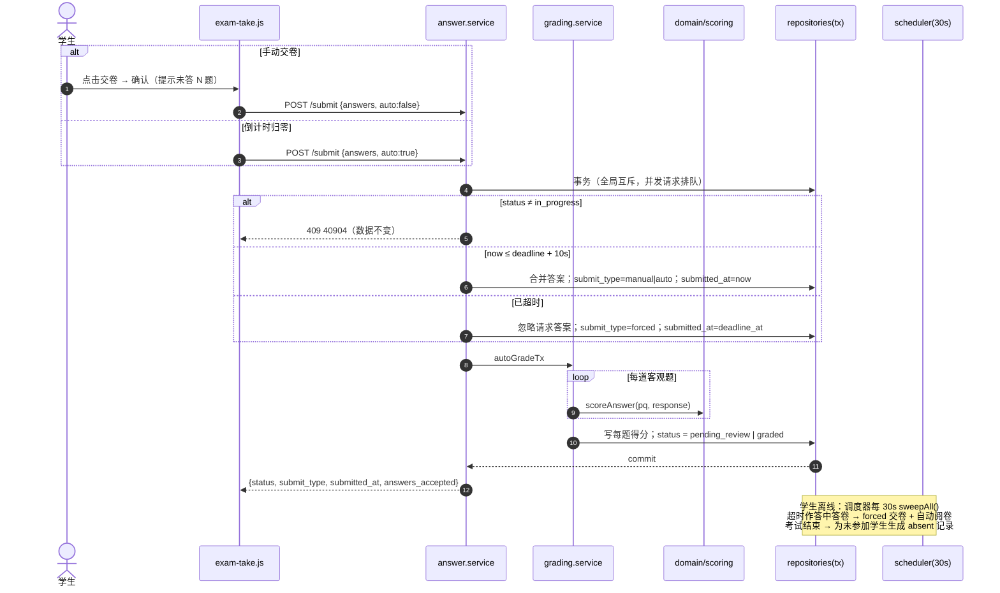

# 基于 Node.js 的在线考试系统的设计与实现

> 本科毕业设计（论文）初稿。学校、学院、专业、姓名、学号、指导教师等封面信息及格式须按所在学校模板由作者本人补全，详见 `thesis/README.md`。

---

## 摘　要

传统纸质考试在命题组卷、阅卷登分和成绩分析等环节依赖大量人工，存在组卷效率低、客观题阅卷重复劳动多、统计反馈滞后、组织成本高等问题。在线考试系统把“题库—组卷—考试—阅卷—统计”的完整流程迁移到浏览器中，可以明显减轻教师负担，也能为教学改进提供数据依据。

本文设计并实现了一个基于 Node.js 的轻量级在线考试系统。系统采用 B/S 架构，服务端只使用 Node.js 内置模块（`node:http`、`node:crypto`、`node:fs`、`node:test`），不引入任何第三方依赖，按“接入层—路由层—中间件—控制器—服务层—领域层—仓储层—存储层”分层组织代码。数据以单文件 JSON 方式持久化，通过“写临时文件—fsync—原子重命名”和串行事务互斥锁保证一致性，并通过统一的仓储接口预留迁移到 MySQL 的路径。前端是不依赖框架、无需构建的原生 JavaScript 单页应用，使用 hash 路由。系统面向管理员、教师、学生三类角色，实现了 33 条功能需求和 62 个 REST 接口，覆盖用户与班级管理、五种题型的题库管理、手动与随机组卷、考试发布与监控、在线答题（服务端时间倒计时、自动保存、断网重试、幂等交卷、到时强制交卷与缺考记录）、客观题自动判分与简答题人工批改、成绩发布与统计分析。安全方面采用 scrypt 加盐哈希、服务端会话令牌、基于角色的访问控制与数据归属两级校验、内容安全策略（CSP）和纯文本渲染防 XSS 等措施。

测试结果表明：后端 134 条单元、集成与非功能用例和 8 条端到端用例在测试中未出现失败，源码行覆盖率为 96.70%，分支覆盖率为 87.70%，函数覆盖率为 95.02%；在 1000 名用户、2000 道题目、5000 份答卷的数据规模下，普通查询接口平均响应时间为 1.7~12.3ms，200 名学生并发保存与交卷的成功率为 100%。测试中发现的 2 个低严重度缺陷均已修复并回归通过。

**关键词**：在线考试系统；Node.js；自动阅卷；单页应用；JSON 存储；访问控制

---

## Abstract

Traditional paper-based examinations rely heavily on manual work in question setting, paper assembly, grading, score registration and analysis. This leads to low assembly efficiency, repetitive grading of objective questions, delayed statistical feedback and high organizational cost. An online examination system moves the whole workflow of "question bank, paper assembly, examination, grading and statistics" into the browser, which reduces teachers' workload and provides data for improving teaching.

This thesis designs and implements a lightweight online examination system based on Node.js. The system follows the Browser/Server architecture. The server uses only built-in Node.js modules (`node:http`, `node:crypto`, `node:fs` and `node:test`) with zero third-party dependencies, and its code is organized into access, routing, middleware, controller, service, domain, repository and storage layers. Data is persisted in a single JSON file. Consistency is guaranteed by atomic writes (write to a temporary file, fsync, then rename) and a serialized transaction lock, and a unified repository interface leaves a migration path to MySQL. The front end is a framework-free, build-free native JavaScript single-page application with hash-based routing. For three roles (administrator, teacher and student), the system implements 33 functional requirements and 62 REST APIs. They cover user and class management, a question bank with five question types, manual and random paper assembly, exam publishing and monitoring, online answering (server-time countdown, auto-save, retry after network loss, idempotent submission, forced submission on timeout and absence records), automatic grading of objective questions, manual grading of essay questions, result publishing and statistical analysis. Security measures include salted scrypt password hashing, server-side session tokens, two-level checks with role-based access control and resource ownership, a Content Security Policy and text-only rendering against XSS.

Testing shows that the 134 back-end unit, integration and non-functional test cases and the 8 end-to-end cases produced no failures. Source line coverage is 96.70%, branch coverage is 87.70% and function coverage is 95.02%. With 1,000 users, 2,000 questions and 5,000 submissions, the average response time of ordinary query APIs is 1.7 to 12.3 ms, and the success rate of concurrent saving and submission by 200 students is 100%. The two low-severity defects found in testing were fixed and passed regression testing.

**Keywords**: online examination system; Node.js; automatic grading; single-page application; JSON storage; access control

---

## 第1章　绪论

### 1.1 研究背景

考试是检验教学效果、衡量学生掌握程度的基本手段。高校的随堂测验和期中、期末考试大多仍采用纸质试卷：教师在个人文档里命题、排版，再印刷、监考、阅卷、登分，最后手工计算统计数据。这种方式主要有四个问题：

1. **组卷效率低**。题目散落在各自的文档中，无法按题型、难度、知识点复用和抽取，每次组卷都要重新整理；
2. **阅卷工作量大**。单选、多选、判断、填空等客观题本可以机器判定，人工逐份核对既费时又容易出错；
3. **统计分析薄弱**。平均分、及格率、分数段分布、每题正确率等指标靠手工计算，难以及时反馈到教学中；
4. **组织成本高**。纸质考试需要固定考场，还有印刷与回收开销，小规模测验难以高频开展。

随着校园网和个人计算设备的普及，基于浏览器的在线考试已经可行。学生在任意终端打开网页即可作答，系统自动计时、自动保存、自动判分，教师在线完成主观题批改和统计分析，组织成本和教师工作量都明显下降。

### 1.2 研究意义

本课题的意义主要体现在以下三个方面：

- **实践意义**：实现一个功能完整、可部署运行的在线考试系统，覆盖从题库到统计的完整闭环，可用于课程随堂测验等小规模考试场景；
- **技术意义**：在“零第三方依赖”的约束下，用 Node.js 内置模块自行实现路由、鉴权、事务化持久化、判分与统计等核心机制，便于深入理解 Web 系统中 HTTP 处理、会话管理、并发控制、数据一致性等基本原理；
- **工程意义**：完整实践“需求分析—系统设计—编码实现—测试验证”的软件工程流程。通过需求追踪矩阵把每条需求对应到设计模块、接口和测试用例，体现可追溯的工程方法。

### 1.3 国内外研究现状

**（1）在线考试系统的发展**

在线考试系统大体经历了三个阶段。第一阶段是基于局域网的 C/S 架构考试软件，客户端需单独安装，部署与升级成本较高。第二阶段是基于 B/S 架构的 Web 考试系统，客户端只需浏览器，服务端常采用 Java EE、ASP.NET、PHP 等技术，并以关系型数据库存储题库与答卷。第三阶段是近年来与在线教育平台、学习管理系统（LMS）融合的云化考试服务，在题库、组卷和统计之外，进一步集成了防作弊监考、学习分析等功能。

国外较早把在线测验作为学习管理系统的基础模块，例如开源学习管理平台 Moodle 内置了测验（Quiz）模块，支持多种题型、题库分类与随机抽题。国内高校普遍使用的在线教学平台和慕课平台也提供作业与考试功能。总的来看，题库管理、组卷、在线作答、自动阅卷和成绩统计已经成为在线考试系统的公认核心功能；而切屏检测、人脸识别、视频监考等防作弊手段往往依赖额外的硬件与算法支持，通常作为增强功能出现。

**（2）自动阅卷技术**

客观题自动阅卷技术已经十分成熟：单选、判断题直接比对，多选题按集合比较，填空题按标准答案文本匹配（通常配合去空格、忽略大小写、多个可接受答案等规则）。多选题是否给部分分、填空题如何按空拆分分值等规则因系统而异，需要在需求阶段明确。主观题（简答、论述）的自动评分涉及自然语言处理，目前仍主要作为辅助手段，正式考试中一般采用教师人工批改或“机评加人工复核”的方式。本系统对客观题完全自动判分，简答题由教师人工批改，符合本科课程考试的实际需要。

**（3）Web 系统技术的发展**

服务端方面，Node.js 基于 V8 引擎和事件驱动、非阻塞 I/O 模型，适合 I/O 密集型的 Web 接口服务，并且前后端可以统一使用 JavaScript。其官方运行时内置了 HTTP 服务、加密、文件系统和测试运行器等模块[3]，小型系统在不引入框架的情况下也能完成主要功能。接口设计方面，REST 风格的 JSON 接口已成为前后端分离的主流方式，OpenAPI 规范[4]为接口契约提供了机器可读的描述格式。身份认证方面，常见方案有服务端会话和基于 JSON Web Token（JWT，RFC 7519[1]）的无状态令牌；前者便于即时吊销，后者便于水平扩展。安全方面，OWASP Top 10[2] 总结了访问控制失效、注入、跨站脚本等常见 Web 安全风险，内容安全策略（CSP）[7] 则为浏览器端提供了限制脚本来源的纵深防御手段。前端方面，单页应用（SPA）通过前端路由在不刷新页面的情况下切换视图；在规模较小的系统中，直接使用浏览器原生支持的 ES Module 也能组织模块化代码，而无需构建工具。

综上，在线考试系统的业务模型已经比较清晰，技术实现选择较多。本课题不追求功能大而全，而是在严格的技术约束下，把考试流程中对正确性要求最高的环节（时间控制、交卷幂等、并发一致性、判分与统计口径、权限隔离）实现扎实、验证充分。

### 1.4 研究内容

本文主要完成以下工作：

1. **需求分析**：明确管理员、教师、学生三类角色的权限边界，整理 33 条功能需求（P0 29 条、P1 2 条、P2 2 条）和 15 条非功能需求，绘制用例图与业务流程图，建立需求追踪矩阵；
2. **系统设计**：完成技术选型，设计分层架构、9 个功能模块、13 个实体的数据模型（JSON 存储与等价的 MySQL DDL）、62 个接口的 OpenAPI 契约、统一错误码体系、安全方案和关键业务时序；
3. **系统实现**：实现零依赖的 Node.js 后端与原生 JavaScript 单页前端（26 个页面、28 条路由），重点解决 JSON 存储的原子写与串行事务、服务端时间权威的倒计时与截止宽限、交卷幂等、到时强制交卷与缺考生成、五种题型自动判分、统计计算等问题；
4. **系统测试**：设计单元、接口集成、端到端和非功能（安全、可靠性、性能）测试，统计覆盖率，记录并跟踪修复缺陷。

### 1.5 论文结构

全文共六章：

- 第 1 章绪论，介绍研究背景、意义、国内外现状和本文的研究内容；
- 第 2 章需求分析，从可行性、角色用例、功能需求、非功能需求和业务流程五个方面描述系统要做什么；
- 第 3 章系统设计，给出技术选型、架构、模块、数据库、接口、安全和关键流程设计；
- 第 4 章系统实现，介绍开发环境和关键技术的具体实现，配合核心代码与界面截图；
- 第 5 章系统测试，介绍测试环境、策略、用例统计、覆盖率、端到端测试、非功能测试以及缺陷修复情况；
- 第 6 章总结与展望，总结本文工作，分析不足并提出改进方向。

---

## 第2章　需求分析

### 2.1 可行性分析

**（1）技术可行性**。Node.js 18 及以上版本内置 `node:http`（HTTP 服务）、`node:crypto`（scrypt 慢哈希、密码学安全随机数、常量时间比较）、`node:fs/promises`（文件读写与 fsync）、`node:test`（测试运行器与覆盖率统计）等模块，已覆盖 Web 服务、安全、持久化与测试的全部需要。现代浏览器原生支持 ES Module、`fetch`、`localStorage` 与 SVG，前端无需框架即可实现单页应用。因此在“零第三方依赖”的约束下，技术上是可行的。

**（2）经济可行性**。系统只需一台安装了 Node.js 的普通计算机即可运行，不需要数据库服务器和商业软件许可；客户端只需浏览器。开发与部署成本很低。

**（3）操作可行性**。系统界面为中文，三类角色各有独立工作台，核心操作（学生开始考试、教师发布考试）从首页出发 3 次点击以内可达；危险操作有二次确认。用户具备基本的计算机操作能力即可使用。

**（4）规模可行性**。课题设定的规模是单场考试同时在线学生不超过 200 人，系统总数据量约为 1000 名用户、2000 道题目、5000 份答卷。这一规模下，数据可以全量驻留内存，单进程部署能够满足性能要求（第 5 章的实测数据验证了这一点）。

### 2.2 系统角色与用例

系统有三类用户角色，另外有一个“系统定时器”作为参与者，负责超时兜底交卷和缺考记录生成。

表 2-1　系统角色

| 角色 | 描述 | 典型人数（设计参考） |
| --- | --- | --- |
| 管理员 | 系统维护人员，管理账号与班级，不参与命题与考试 | 1~3 |
| 教师 | 命题、组卷、发布考试、批改主观题、查看统计 | 10~50 |
| 学生 | 隶属于一个班级，参加本班考试并查看自己的成绩 | 100~1000 |
| 系统定时器 | 周期性执行超时强制交卷与缺考生成 | — |

角色的权限边界见表 2-2，其中“本人”表示仅限自己创建或所属的数据。

表 2-2　权限矩阵（节选）

| 功能 | 管理员 | 教师 | 学生 |
| --- | :---: | :---: | :---: |
| 登录 / 退出 / 修改本人密码 | ✔ | ✔ | ✔ |
| 用户管理、班级管理（增删改） | ✔ | ✘ | ✘ |
| 题库管理、组卷与试卷管理 | ✘ | ✔（本人） | ✘ |
| 发布 / 修改 / 取消考试、作答监控 | ✘ | ✔（本人考试，限任课班级） | ✘ |
| 在线答题、自动保存、交卷 | ✘ | ✘ | ✔（本人答卷） |
| 简答题人工批改、发布成绩 | ✘ | ✔（本人考试） | ✘ |
| 查看成绩单与统计分析 | ✔（只读） | ✔（本人考试） | ✘ |
| 查询本人成绩与答卷回顾 | ✘ | ✘ | ✔（成绩发布后） |
| 系统数据概览 | ✔ | ✘ | ✘ |

系统用例图见图 2-1（PlantUML 源文件为 `requirements/用例图.puml`，下面用 Mermaid 给出等价的简化表示）。



图 2-1　系统用例图

### 2.3 功能需求

功能需求按模块编号为 `FR-模块代号-序号`，共 9 个模块 33 条，汇总于表 2-3。

表 2-3　功能需求汇总

| 模块 | 编号 | 需求名称 | 主要内容 | 优先级 |
| --- | --- | --- | --- | --- |
| 认证与会话 | FR-AUTH-01 | 用户登录 | 账号密码登录；统一提示“账号或密码错误”；禁用拒绝；连续 5 次错误锁定 10 分钟 | P0 |
| | FR-AUTH-02 | 退出与会话校验 | 退出即令牌失效；受保护接口校验会话；刷新后恢复登录态；滑动续期 | P0 |
| | FR-AUTH-03 | 修改本人密码 | 校验原密码；6~32 位含字母和数字；成功后其他会话失效 | P1 |
| 用户管理 | FR-USER-01 | 用户列表查询 | 按角色、班级、状态、关键字筛选分页；不返回哈希与盐 | P0 |
| | FR-USER-02 | 新增用户 | 账号唯一（4~20 位）；学生必须指定班级；密码加盐哈希 | P0 |
| | FR-USER-03 | 编辑/禁用/重置密码/删除 | 禁用即踢下线；有业务数据的用户只能禁用；不能禁用自己 | P0 |
| 班级管理 | FR-CLASS-01 | 班级增删改查 | 名称唯一；有学生或考试关联时不可删除 | P0 |
| | FR-CLASS-02 | 班级成员管理 | 分配学生与任课教师；学生转班需二次确认 | P0 |
| 题库管理 | FR-QB-01 | 新增题目 | 单选、多选、判断、填空、简答五种题型；难度、标签、分值、解析 | P0 |
| | FR-QB-02 | 编辑与删除题目 | 仅限本人；已组卷题目保留快照；被引用题目逻辑删除 | P0 |
| | FR-QB-03 | 检索与筛选 | 题型、难度、标签、关键字组合筛选；返回按题型和难度的数量汇总 | P0 |
| | FR-QB-04 | 知识点标签管理 | 标签增删改；重命名同步关联题目 | P1 |
| | FR-QB-05 | 批量导入 | JSON 批量导入，逐条校验，单次 ≤200 题 | P2 |
| 组卷 | FR-PAPER-01 | 手动组卷 | 逐题挑选；按题型分组排序；自动算总分；保存题目快照 | P0 |
| | FR-PAPER-02 | 随机抽题组卷 | 按题型、数量、分值、难度、标签规则无放回抽题；题量不足整体失败并提示；可替换单题 | P0 |
| | FR-PAPER-03 | 试卷管理 | 列表、学生视角预览、删除；已被考试引用的试卷锁定，可复制为新试卷 | P0 |
| 考试管理 | FR-EXAM-01 | 发布考试 | 时间窗口、时长、参考班级（限任课班级）、及格线（默认 60%） | P0 |
| | FR-EXAM-02 | 考试管理与监控 | 未开始可修改或取消；进行中仅可延长；作答监控 | P0 |
| | FR-EXAM-03 | 学生考试列表 | 本班考试；未开始/可参加/已完成/已错过等状态 | P0 |
| 在线答题 | FR-ANS-01 | 开始/继续作答 | 服务端记录开始时刻；截止时刻 = min(开始 + 时长, 结束时间)；再次进入不重置；不返回答案 | P0 |
| | FR-ANS-02 | 答题界面与倒计时 | 按题型分区；答题卡导航与标记；服务端时间倒计时；剩余 5 分钟提醒 | P0 |
| | FR-ANS-03 | 自动保存 | 选项变更立即保存，文本停 2 秒保存，30 秒兜底；10 秒网络宽限；失败本地暂存重试 | P0 |
| | FR-ANS-04 | 手动交卷与防重复 | 确认未答题数；按钮防抖；服务端幂等 | P0 |
| | FR-ANS-05 | 到时自动交卷 | 前端归零自动交；服务端兜底强制交卷；考试结束生成缺考记录 | P0 |
| 阅卷与成绩 | FR-GRADE-01 | 客观题自动阅卷 | 单选/判断精确匹配；多选全对才得分；填空逐空计分 | P0 |
| | FR-GRADE-02 | 简答题人工批改 | 按学生或按题目批改；0~分值、1 位小数；保存并下一份 | P0 |
| | FR-GRADE-03 | 发布成绩 | 考试结束且全部批改完成才可发布；可撤回 | P0 |
| 统计 | FR-STAT-01 | 学生成绩与答卷回顾 | 发布后可见；按教师设置显示答案、解析与评语 | P0 |
| | FR-STAT-02 | 教师成绩单 | 含缺考者；客观分、主观分、总分、排名、是否及格 | P0 |
| | FR-STAT-03 | 概要统计 | 应考/实考/缺考人数，平均分（2 位小数），最高/最低分，及格率（1 位小数） | P0 |
| | FR-STAT-04 | 分数段分布 | 按得分率分 5 段，表格加柱状图 | P0 |
| | FR-STAT-05 | 每题正确率分析 | 客观题正确率、选项分布；简答题得分率；可升序定位难题 | P0 |
| | FR-STAT-06 | 成绩导出与系统概览 | CSV（UTF-8 BOM）导出；管理员概览 | P2 |

需求阶段还明确了几条对实现影响较大的业务假设：考试时间以服务端时钟为准，客户端时间只用于显示；同一场考试每名学生只能作答一次；多选题与标准答案完全一致才得满分，少选、错选、多选都得 0 分；填空题判分时去除首尾空格、忽略英文大小写，一空可以配置多个可接受答案。

### 2.4 非功能需求

非功能需求共 15 条，每条都给出了可验证的验收方法，见表 2-4。

表 2-4　非功能需求

| 类别 | 编号 | 名称 | 要求要点 |
| --- | --- | --- | --- |
| 性能 | NFR-01 | 接口响应时间 | 1000 用户 / 2000 题 / 100 场考试 / 5000 份答卷规模下，普通查询平均 ≤300ms，统计类 ≤1s |
| | NFR-02 | 并发答题 | 200 名学生同时保存、交卷，成功率 100%，无数据丢失或互相覆盖 |
| | NFR-03 | 首屏加载 | 首屏静态资源 ≤300KB，可交互时间 ≤2s |
| 安全 | NFR-04 | 密码存储 | 慢哈希（单次 ≥10ms），每用户独立随机盐（≥16 字节），常量时间比较 |
| | NFR-05 | 会话与登录防护 | 令牌 ≥32 字节安全随机数，经请求头携带；空闲 2 小时过期；退出、禁用、改密立即失效；5 次错误锁定 10 分钟 |
| | NFR-06 | 越权校验 | 服务端 RBAC 角色校验加数据归属校验，越权返回 403 |
| | NFR-07 | 防重复交卷与时间防篡改 | 交卷幂等；所有时刻取服务端时间；截止 +10 秒后不再接受新答案 |
| | NFR-08 | 答案保密 | 作答期间学生端任何接口不返回答案和解析；发布前看不到分数 |
| | NFR-09 | 输入校验与 XSS | 字段级校验；请求体 ≤1MB；用户内容按文本渲染；禁止路径穿越 |
| 可靠性与可用性 | NFR-10 | 持久化可靠性 | 写临时文件后原子重命名；写操作串行化；重启后数据完整 |
| | NFR-11 | 作答断点恢复 | 刷新、重开浏览器、短暂断网后恢复已保存答案，剩余时间连续计算 |
| | NFR-12 | 易用性 | 中文界面；核心操作 ≤3 次点击；表单有加载与字段级错误提示；危险操作二次确认 |
| 可维护性 | NFR-13 | 分层与可替换存储 | 控制层、服务层、数据访问层分离；替换数据库只需新增数据访问实现 |
| | NFR-14 | 可测试性 | 核心逻辑有自动化测试，一条命令运行；核心模块语句覆盖率 ≥80%；提供演示数据脚本 |
| 兼容性 | NFR-15 | 运行与浏览器兼容 | Node.js ≥18 无依赖一条命令启动；主流浏览器最近两个大版本可用；答题页 375px 宽度可作答 |

### 2.5 业务流程分析

#### 2.5.1 考试全生命周期

一场考试从准备到统计分析，经过以下环节：管理员创建班级和账号，教师录入题目并组卷，然后发布考试；学生在时间窗口内作答并交卷（也可能由前端到时自动交卷，或由服务端兜底强制交卷）；系统自动判分客观题，教师批改简答题；最后教师发布成绩，学生查询成绩，教师和管理员查看统计。完整流程见图 2-2。


图 2-2　考试全生命周期业务流程图

#### 2.5.2 答卷状态转换

答卷是考试流程中状态最复杂的实体，它的状态转换见图 2-3。“已交卷”只是交卷事务内部的瞬时逻辑状态：交卷与自动阅卷在同一个事务内完成，持久化后只会出现“作答中（in_progress）”“待批改（pending_review）”“已批改（graded）”三种状态，交卷方式另用 `submit_type` 字段记录，取值为 manual（手动）、auto（前端到时自动）、forced（服务端强制）和 absent（缺考）。



图 2-3　答卷状态图

#### 2.5.3 考试状态

考试状态不存入数据库，由服务端根据当前时间和取消标记实时计算，避免依靠定时器修改状态而引起不一致，见表 2-5。

表 2-5　考试状态及允许的操作

| 状态 | 判定条件 | 教师可执行操作 | 学生可执行操作 |
| --- | --- | --- | --- |
| 未开始 | 当前时间 < 开始时间 | 修改、取消 | 查看信息 |
| 进行中 | 开始时间 ≤ 当前时间 ≤ 结束时间 | 延长结束时间、作答监控、批改已交卷答卷 | 开始/继续作答、交卷 |
| 已结束 | 当前时间 > 结束时间 | 批改、发布成绩、统计 | 等待成绩 / 查看成绩 |
| 已取消 | 教师在未开始时取消 | 无 | 不可见 |

### 2.6 本章小结

本章从技术、经济、操作和规模四个方面论证了系统的可行性，明确了三类角色的权限边界，归纳了 9 个模块共 33 条功能需求和 15 条可验证的非功能需求，并用流程图与状态图描述了考试全生命周期和答卷状态转换，为后续设计提供依据。

---

## 第3章　系统设计

### 3.1 技术选型

技术选型要满足三条约束：服务端只使用运行时内置能力（C-01）；前端为原生 JavaScript 单页应用，不使用框架和构建工具（C-02）；采用 JSON 文件持久化、单进程部署（C-03）。在此前提下，各层选型及理由见表 3-1。

表 3-1　技术选型及理由

| 层面 | 选型 | 理由 |
| --- | --- | --- |
| 运行时 | Node.js ≥18，ES Module（`.mjs`） | 内置 HTTP、加密、文件系统、测试模块，满足全部需要；跨平台；前后端统一使用 JavaScript |
| 第三方依赖 | 零依赖 | 不需要 `npm install`，`node server.mjs` 一条命令启动；没有供应链风险和版本漂移；路由、鉴权、原子写、判分等关键代码都可以自主讲清楚 |
| Web 框架 | 自研轻量路由 | 只需“方法 + 路径参数匹配 + 角色声明”；路由表集中声明角色，便于审计 RBAC |
| 存储 | 单文件 JSON + 仓储层封装 | 课题规模下数据可全量驻留内存，查询是内存遍历；文件可直接查看，便于演示；通过仓储接口隔离，可迁移 MySQL |
| 鉴权 | scrypt + 16 字节随机盐；32 字节随机令牌；服务端会话表 | scrypt 是内置的慢哈希，抗 GPU 暴力破解；服务端会话可即时吊销 |
| 前端 | 原生 JS SPA、hash 路由、浏览器直接加载 ES Module | 无构建步骤；hash 路由不需要服务端做路由回退；首屏资源易控制 |
| 图表 | 原生 SVG 柱状图组件 | 只需要分数段柱状图，不必引入图表库 |
| 测试 | `node --test` + `--experimental-test-coverage` | 内置能力，零依赖；端到端测试另用 Playwright 驱动浏览器（只用于测试环境） |

**关于会话方案的选择**。JWT（RFC 7519[1]）把声明签名后交给客户端保存，服务端不需要存储会话，适合分布式部署；但令牌签发后在过期前一直有效，若要实现“退出、禁用、改密后立即失效”（NFR-05），就要额外维护黑名单，失去无状态的优势。本系统是单进程部署，选用“随机令牌 + 服务端会话表”更简单直接：库中只存令牌的 SHA-256 摘要，吊销时删除会话记录即可。

**关于 JSON 存储的局限与对策**。JSON 文件存储有四个固有问题，设计中分别给出了应对措施，见表 3-2。

表 3-2　JSON 存储的局限与应对

| 局限 | 应对措施 |
| --- | --- |
| 并发写覆盖 | 单进程内全局事务互斥锁，读—校验—写在同一事务内串行完成 |
| 写入中断导致文件损坏 | 写 `db.json.tmp` → `fsync` → `rename` 原子替换 |
| 每次写入都全量序列化 | 写队列合并：同一时间窗内的多次提交合并为一次落盘；会话续期每 60 秒最多写一次 |
| 无法水平扩展 | 课题规模单进程足够；需要扩展时按仓储接口迁移到 MySQL |

### 3.2 系统总体架构

系统采用 B/S 架构。浏览器端单页应用通过 HTTP JSON 接口（`/api/*`）访问服务端，静态资源由同一端口提供。服务端按职责自上而下分为八层，见图 3-1（PlantUML 源文件为 `design/架构图.puml`）。



图 3-1　系统分层架构图

各层的职责与约束见表 3-3。分层的关键约束是：服务层不导入 `node:fs`，也不感知 HTTP；领域层只包含无副作用的纯函数；仓储层不包含业务规则。这样，业务规则可以脱离 HTTP 和文件系统做单元测试，替换存储实现时也不必改动上层代码（NFR-13）。

表 3-3　各层职责

| 层 | 职责 | 禁止 |
| --- | --- | --- |
| 接入层 | 创建 HTTP 服务；`/api/*` 交给路由，其余交给静态文件服务；设置安全响应头；兜底捕获异常转为 50000 | 包含业务逻辑 |
| 路由层 | 路由表 `{method, path, roles, handler}`；字面量路径优先于参数路径；无匹配 40400，方法不符 40500 | — |
| 中间件 | 解析 `Authorization: Bearer`；校验会话与用户状态；角色不符 40300 | 做资源归属校验 |
| 控制器 | 从参数、查询串、请求体取参并校验，调用服务，返回数据 | 直接访问仓储 |
| 服务层 | 业务规则、资源归属校验（40301）、状态机校验；写操作包在事务内 | 导入文件系统；感知 HTTP |
| 领域层 | 密码哈希、题目结构校验、判分、状态计算、随机抽题、统计、CSV | 访问仓储 |
| 仓储层 | 按实体封装查询与增删改，对外返回深拷贝 | 包含业务规则 |
| 存储层 | 内存数据、互斥锁、序列号、原子落盘 | — |

一个 API 请求的处理管线为：设置安全响应头 → 路由匹配 → 读取 JSON 请求体（≤1MB）→ 认证（公开接口除外）→ 角色校验 → 控制器 → 以 `{code:0, message:'ok', data}` 返回。任一环节抛出业务异常 `AppError` 时，按其 HTTP 状态码与业务码返回；其他异常记录日志并返回 50000。

### 3.3 功能模块设计

按业务边界，系统划分为 9 个功能模块，对应 33 条功能需求和 62 个接口，见图 3-2 与表 3-4。



图 3-2　系统功能模块图

表 3-4　模块划分

| 模块 | 对应需求 | 后端主要文件 | 前端页面 | 接口数 |
| --- | --- | --- | --- | ---: |
| M1 认证与会话 | FR-AUTH-01~03 | auth.service、domain/password、domain/token、middleware/auth | login、profile | 4 |
| M2 用户管理 | FR-USER-01~03 | user.service | admin/users | 6 |
| M3 班级管理 | FR-CLASS-01~02 | class.service | admin/classes、admin/class-members | 9 |
| M4 题库管理 | FR-QB-01~05 | tag.service、question.service、domain/question-rules | teacher/questions、question-edit、tags、question-import | 10 |
| M5 组卷 | FR-PAPER-01~03 | paper.service、domain/random-picker | teacher/papers、paper-edit、paper-preview | 8 |
| M6 考试管理 | FR-EXAM-01~02 | exam.service、domain/exam-status | teacher/exams、exam-edit、exam-monitor、admin/exams | 6 |
| M7 在线答题 | FR-EXAM-03、FR-ANS-01~05 | answer.service、scheduler.service、domain/scoring | student/exams、exam-notice、exam-take | 5 |
| M8 阅卷与成绩 | FR-GRADE-01~03、FR-STAT-01 | grading.service | teacher/grading、student/results、result-detail | 7 |
| M9 统计分析 | FR-STAT-02~06 | stat.service、domain/statistics、domain/csv | shared/scores、submission-detail、admin/overview | 7 |
| 合计 | 33 | | 26 个页面 | 62 |

### 3.4 数据库设计

#### 3.4.1 概念结构设计

系统共有 13 个实体（集合），其中 `class_teachers`、`question_tags`、`exam_classes` 是多对多关联。主要实体之间的关系见图 3-3（PlantUML 源文件为 `design/ER图.puml`）。



图 3-3　系统 E-R 图

#### 3.4.2 关键设计决策

1. **试卷快照**。`paper_questions` 在组卷时复制题干、选项、答案、解析、难度、标签和分值。此后题库中的修改或逻辑删除都不影响已组试卷和已发布考试，保证同一场考试的题目内容和判分依据稳定；
2. **试卷锁定**。只要存在引用某试卷的考试，该试卷就不能编辑和删除。锁定状态通过查询引用关系得出，不额外存字段；
3. **考试状态不存储**。只存 `cancelled_at`，状态由 `start_time`、`end_time` 和当前时间计算；
4. **答卷唯一**。`(exam_id, student_id)` 唯一，配合事务互斥实现“每人每场只作答一次”；
5. **答案逐题存储**。`answers` 每题一行，支持增量保存，也便于逐题统计和按题批改；
6. **班级快照**。`submissions.class_id` 记录创建答卷时学生所在班级，学生转班不影响历史成绩的归属。

#### 3.4.3 主要表结构

JSON 存储中每个集合对应关系模型中的一张表，字段一一对应；`design/database/ddl.sql` 给出了等价的 MySQL 8 DDL。下面列出核心表的结构（类型按 MySQL DDL 表述）。

表 3-5　用户表 users

| 字段 | 类型 | 约束 | 说明 |
| --- | --- | --- | --- |
| id | BIGINT UNSIGNED | PK，自增 | 用户 ID |
| username | VARCHAR(20) | 唯一 | 账号（学号/工号），4~20 位字母、数字、下划线 |
| name | VARCHAR(20) | 非空 | 姓名 |
| role | ENUM('admin','teacher','student') | 非空 | 角色 |
| class_id | BIGINT UNSIGNED | FK → classes，可空 | 学生所属班级 |
| status | ENUM('active','disabled') | 默认 active | 状态 |
| password_hash | CHAR(128) | 非空 | scrypt 派生密钥（64 字节 hex） |
| password_salt | CHAR(32) | 非空 | 随机盐（16 字节 hex） |
| failed_login_count | INT UNSIGNED | 默认 0 | 连续密码错误次数 |
| locked_until | DATETIME(3) | 可空 | 锁定截止时刻 |
| created_at / updated_at | DATETIME(3) | 非空 | 创建、更新时间 |

表 3-6　会话表 sessions

| 字段 | 类型 | 约束 | 说明 |
| --- | --- | --- | --- |
| id | BIGINT UNSIGNED | PK | 会话 ID |
| token_hash | CHAR(64) | 唯一 | 令牌的 SHA-256 摘要，库中不存明文令牌 |
| user_id | BIGINT UNSIGNED | FK → users | 所属用户 |
| last_active_at | DATETIME(3) | 非空 | 最近活跃时间 |
| expires_at | DATETIME(3) | 非空 | 过期时刻 = 最近活跃 + 2 小时（滑动过期） |

表 3-7　题目表 questions

| 字段 | 类型 | 约束 | 说明 |
| --- | --- | --- | --- |
| id | BIGINT UNSIGNED | PK | 题目 ID |
| teacher_id | BIGINT UNSIGNED | FK → users | 创建教师 |
| type | ENUM('single','multiple','judge','fill','essay') | 非空 | 题型 |
| stem | TEXT | 非空 | 题干（≤2000 字，填空题以 `___` 标记空位） |
| options | JSON | 非空 | 选项 `[{"key":"A","text":"…"}]` |
| answer | JSON | 可空 | 标准答案，形状随题型 |
| analysis | TEXT | 非空 | 解析 |
| difficulty | ENUM('easy','medium','hard') | 非空 | 难度 |
| score | DECIMAL(6,1) | 非空 | 默认分值 |
| blank_count | INT UNSIGNED | 默认 0 | 填空题空数 |
| deleted_at | DATETIME(3) | 可空 | 逻辑删除时刻 |

表 3-8　试卷题目快照表 paper_questions

| 字段 | 类型 | 约束 | 说明 |
| --- | --- | --- | --- |
| id | BIGINT UNSIGNED | PK | 试卷题目 ID |
| paper_id | BIGINT UNSIGNED | FK → papers，级联删除 | 所属试卷 |
| question_id | BIGINT UNSIGNED | FK → questions，可空 | 来源题目 |
| seq | INT UNSIGNED | (paper_id, seq) 唯一 | 题号 |
| type / stem / options / answer / analysis / difficulty / tags | — | — | 组卷时的题目内容快照 |
| score | DECIMAL(6,1) | 非空 | 本卷中该题分值 |
| blank_count | INT UNSIGNED | — | 空数 |

表 3-9　考试表 exams

| 字段 | 类型 | 约束 | 说明 |
| --- | --- | --- | --- |
| id | BIGINT UNSIGNED | PK | 考试 ID |
| teacher_id / paper_id | BIGINT UNSIGNED | FK | 发布教师、使用试卷 |
| title | VARCHAR(100) | 非空 | 考试名称 |
| start_time / end_time | DATETIME(3) | CHECK end > start | 时间窗口 |
| duration_minutes | INT UNSIGNED | CHECK ≥1 | 考试时长 |
| pass_score | DECIMAL(7,1) | 非空 | 及格线 |
| shuffle_options | TINYINT(1) | 默认 0 | 选项是否乱序 |
| cancelled_at | DATETIME(3) | 可空 | 非空即已取消 |
| results_published / results_published_at | TINYINT(1) / DATETIME(3) | — | 成绩是否已发布及时间 |
| allow_review | TINYINT(1) | 默认 1 | 发布后学生可否查看答案与解析 |
| absent_generated | TINYINT(1) | 默认 0 | 缺考记录是否已生成 |

表 3-10　答卷表 submissions

| 字段 | 类型 | 约束 | 说明 |
| --- | --- | --- | --- |
| id | BIGINT UNSIGNED | PK | 答卷 ID |
| exam_id / student_id | BIGINT UNSIGNED | (exam_id, student_id) 唯一 | 每人每场仅一份 |
| class_id | BIGINT UNSIGNED | FK | 创建答卷时班级快照 |
| status | ENUM('in_progress','pending_review','graded') | 非空 | 答卷状态 |
| submit_type | ENUM('manual','auto','forced','absent') | 可空 | 交卷方式 |
| started_at | DATETIME(3) | 可空 | 服务端开始时刻 |
| deadline_at | DATETIME(3) | 可空，有索引 | min(开始 + 时长, 考试结束时间) |
| submitted_at / last_saved_at | DATETIME(3) | 可空 | 交卷时刻、最后保存时刻 |
| objective_score / subjective_score / total_score | DECIMAL(7,1) | 可空 | 客观分、主观分、总分 |

表 3-11　逐题作答表 answers

| 字段 | 类型 | 约束 | 说明 |
| --- | --- | --- | --- |
| id | BIGINT UNSIGNED | PK | — |
| submission_id | BIGINT UNSIGNED | FK，级联删除；(submission_id, paper_question_id) 唯一 | 所属答卷 |
| paper_question_id | BIGINT UNSIGNED | FK | 对应试卷题目 |
| response | JSON | 可空 | 学生作答，未答为 NULL |
| score | DECIMAL(6,1) | 可空 | 得分，简答未批改为 NULL |
| is_correct | TINYINT(1) | 可空 | 客观题是否满分 |
| comment / graded_by / graded_at | — | 可空 | 评语、批改教师、批改时间 |

其余 `classes`、`class_teachers`、`tags`、`question_tags`、`papers`、`exam_classes` 结构较简单，详见 `design/database/ddl.sql`。

### 3.5 接口设计

#### 3.5.1 接口约定

接口契约以 OpenAPI 3.0[4] 格式编写在 `design/api-contract.yaml` 中，是前后端共同遵循的唯一依据。主要约定如下：

- 所有接口以 `/api` 开头，请求与响应均为 `application/json; charset=utf-8`，请求体上限 1MB；
- 字段统一使用 snake_case；时间统一为 ISO 8601 UTC 字符串；
- 除登录接口外，均需在请求头携带 `Authorization: Bearer <token>`（Bearer 令牌的传输方式参照 RFC 6750[5]）；
- 分页参数为 `page` 和 `page_size`，分页响应为 `{items, total, page, page_size}`；
- 分数最多 1 位小数，平均分保留 2 位小数，百分比为 0~100 的数并保留 1 位小数。

统一响应格式如下：

```json
// 成功
{ "code": 0, "message": "ok", "data": { } }
// 字段校验失败
{ "code": 40000, "message": "参数校验失败",
  "data": { "errors": [ { "field": "options[1].text", "message": "选项内容不能为空" } ] } }
// 重复交卷
{ "code": 40904, "message": "已交卷，请勿重复提交",
  "data": { "submission_id": 12, "status": "graded", "submit_type": "manual",
            "submitted_at": "2026-11-05T08:30:00.000Z", "answers_accepted": false } }
```

HTTP 状态码表示错误类别，`code` 表示具体业务原因。前端按 `code` 分支处理，直接展示 `message`。

#### 3.5.2 错误码设计

业务码为五位数字，前三位与 HTTP 状态码一致，后两位区分具体原因，主要错误码见表 3-12。

表 3-12　主要业务错误码

| code | HTTP | 含义 | 典型场景 |
| --- | --- | --- | --- |
| 0 | 200/201 | 成功 | — |
| 40000 | 400 | 参数校验失败（含字段级 errors） | 题干为空、时间非法 |
| 40001 | 400 | 请求体不是合法 JSON | — |
| 40100 | 401 | 未登录或登录已过期 | 无令牌、伪造令牌、会话过期 |
| 40101 | 401 | 账号或密码错误 | 登录失败 |
| 40300 | 403 | 无权访问该功能（角色不符） | 学生调用教师接口 |
| 40301 | 403 | 无权操作该资源（归属不符） | 教师 A 修改教师 B 的题目 |
| 40302 | 403 | 账号已被禁用 | — |
| 40400 | 404 | 资源不存在 | — |
| 40900 | 409 | 账号/名称已存在 | 账号重复 |
| 40901 | 409 | 资源已被引用，不能删除 | 删除有学生的班级 |
| 40902 | 409 | 当前状态不允许该操作 | 修改进行中考试的试卷 |
| 40903 | 409 | 试卷已被考试引用 | 编辑已锁定试卷 |
| 40904 | 409 | 已交卷，请勿重复提交 | 重复/并发交卷 |
| 40905 | 409 | 当前不在考试时间内 | 开考前或结束后进入考试 |
| 40906 | 409 | 作答时间已到，系统已自动交卷 | 超过截止宽限后保存 |
| 40907 | 409 | 尚有 N 份答卷未完成批改 | 发布成绩时 |
| 41300 | 413 | 请求体过大 | 超过 1MB |
| 42200 | 422 | 题量不足（附 shortages 明细） | 随机组卷 |
| 42900 | 429 | 密码错误次数过多 | 账号锁定 |
| 50000 | 500 | 服务器内部错误 | 未预期异常 |

#### 3.5.3 主要接口

系统共 62 个接口，其中 10 个标注为可选（P1/P2），已全部实现。按模块列出主要接口，见表 3-13（A=管理员，T=教师，S=学生）。

表 3-13　主要接口一览（节选）

| 模块 | 方法与路径 | 角色 | 说明 |
| --- | --- | --- | --- |
| 认证 | POST /api/auth/login | 公开 | 登录，返回令牌与用户信息 |
| | POST /api/auth/logout | A T S | 退出，令牌立即失效 |
| | GET /api/auth/me | A T S | 获取当前用户（刷新恢复登录态） |
| | PUT /api/auth/password | A T S | 修改本人密码 |
| 用户 | GET/POST /api/users | A | 用户列表 / 新增 |
| | PUT /api/users/{id}、POST /api/users/{id}/reset-password | A | 编辑、禁用、重置密码 |
| 班级 | GET/POST /api/classes、GET /api/classes/{id}/members | A（T 只读） | 班级与成员 |
| | POST /api/classes/{id}/students、PUT /api/classes/{id}/teachers | A | 分配学生、任课教师 |
| 题库 | GET/POST /api/questions、PUT/DELETE /api/questions/{id} | T | 题目增删改查与汇总 |
| | POST /api/questions/import | T | 批量导入（可选） |
| 组卷 | POST /api/papers | T | 保存试卷（生成快照） |
| | POST /api/papers/random/generate、POST /api/papers/random/replace | T | 随机抽题、替换单题 |
| | POST /api/papers/{id}/copy | T | 复制为新试卷（可选） |
| 考试 | POST /api/exams、PUT /api/exams/{id}、POST /api/exams/{id}/cancel | T | 发布、修改/延长、取消 |
| | GET /api/exams/{id}/monitor | T | 作答监控 |
| 学生 | GET /api/student/exams | S | 我的考试 |
| | POST /api/student/exams/{id}/start | S | 开始/继续作答 |
| | GET /api/student/results/{exam_id} | S | 成绩与答卷回顾 |
| 答卷 | PUT /api/submissions/{id}/answers | S | 自动保存 |
| | POST /api/submissions/{id}/submit | S | 交卷（幂等） |
| 阅卷 | GET /api/exams/{id}/grading、PUT /api/submissions/{id}/grades | T | 批改总览、评分 |
| | POST /api/exams/{id}/publish-results | T | 发布成绩 |
| 统计 | GET /api/exams/{id}/scores、/scores/export | T A | 成绩单、CSV 导出 |
| | GET /api/exams/{id}/stats/summary、/distribution、/questions | T A | 概要统计、分数段、每题分析 |
| | GET /api/admin/overview | A | 系统概览（可选） |

### 3.6 安全设计

参照 OWASP Top 10[2] 中的常见风险，系统针对各项威胁设计了对应措施，见表 3-14。

表 3-14　安全设计

| 威胁 | 设计措施 | 落点 |
| --- | --- | --- |
| 密码泄露 | `scrypt(pwd, salt16, 64, {N:16384, r:8, p:1})`[6]；每用户独立盐；`timingSafeEqual` 常量时间比较；用户视图白名单输出，永不返回哈希与盐 | domain/password |
| 暴力破解与账号枚举 | 连续 5 次错误锁定 10 分钟；账号不存在时也执行一次 scrypt，消除时序差异；统一提示“账号或密码错误” | auth.service |
| 令牌窃取与伪造 | `randomBytes(32)` 生成 64 位十六进制令牌；只经请求头传输，不进 URL；库中只存 SHA-256；空闲 2 小时过期并滑动续期；退出删除会话，禁用/重置密码删除全部会话，改密删除其他会话 | domain/token、middleware/auth |
| 越权访问 | 两级校验：路由表声明 roles（40300）+ 服务层归属断言（40301）；前端隐藏按钮只是体验优化 | routes、services |
| 答案泄露 | 学生作答视图只输出 7 个白名单字段；成绩发布前分数为 null；`allow_review=false` 时不返回题目 | answer.service、grading.service |
| 时间篡改与重复交卷 | 开始、截止、交卷时刻全部取服务端时钟，忽略请求体中的时间；交卷在互斥事务内检查状态，幂等返回 40904 | answer.service、json-store |
| 注入与 XSS | 字段级校验；请求体 >1MB 返回 41300；前端只用 `textContent` 渲染；CSP 禁止内联脚本 | core/validator、utils/dom |
| 路径穿越 | 解码后 `path.resolve`，结果必须仍在静态根目录内；拒绝含 `\0` 的路径 | core/static |
| 响应头 | `X-Content-Type-Options: nosniff`、`X-Frame-Options: DENY`、`Referrer-Policy: no-referrer`、`Content-Security-Policy: default-src 'self'; img-src 'self' data:; style-src 'self'`；API 响应 `Cache-Control: no-store` | app.mjs |
| CSV 公式注入 | 以 `=`、`+`、`-`、`@`、制表符、回车开头的文本单元格前置单引号 | domain/csv |
| 数据损坏 | 原子写 + 串行写队列；启动时 JSON 解析失败则拒绝启动 | json-store |

### 3.7 关键业务流程设计

#### 3.7.1 登录流程

登录流程的重点是防暴力破解和防账号枚举：账号不存在时仍执行一次等价的 scrypt 计算，使响应时间与“密码错误”相近；密码错误计数与锁定在事务内更新，避免并发探测绕过计数。时序见图 3-4。



图 3-4　登录时序图

#### 3.7.2 开始作答与自动保存

开始作答时，服务端先对该考试执行一次兜底扫描（sweep），再在事务内完成本班校验、时间窗口校验和答卷创建。截止时刻在创建答卷时一次算定，此后再次进入只沿用，不会重置。时序见图 3-5。



图 3-5　开始作答与自动保存时序图

#### 3.7.3 交卷与自动阅卷

交卷是保证数据正确性最关键的环节。手动交卷、前端到时自动交卷和调度器强制交卷三条路径，最终都在同一把全局互斥锁保护的事务中检查答卷状态：只有“作答中”的答卷会被交卷，交卷与客观题判分在同一事务内完成，因此并发请求中只有第一个生效。时序见图 3-6。



图 3-6　交卷与自动阅卷时序图

#### 3.7.4 人工批改与成绩发布

教师进入批改页时，服务端同样先做兜底扫描，然后返回批改进度与待批答卷。教师可以按学生逐份批改，也可以按题目逐题批改。当一份答卷的全部简答题都已评分后，总分 = 客观分 + 主观分，状态变为“已批改”。只有考试已结束且不存在“待批改”或“作答中”答卷时才能发布成绩，否则返回 40907 并附带剩余份数。

### 3.8 本章小结

本章在约束条件下完成了技术选型，设计了八层的服务端架构和 9 个功能模块，给出了 13 个实体的数据模型与核心表结构、62 个接口的统一约定与错误码体系，针对主要安全威胁设计了对应措施，并用时序图描述了登录、作答、交卷和批改的关键流程。

